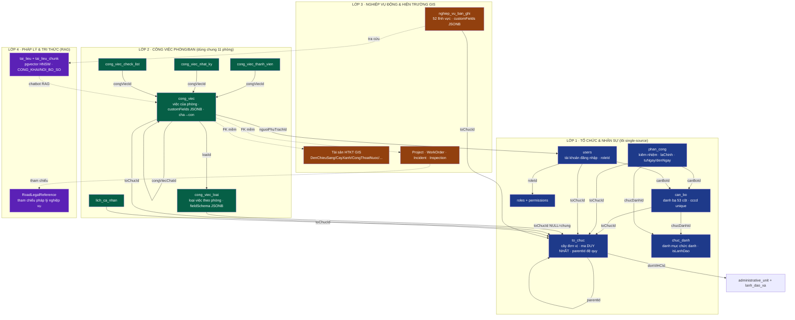
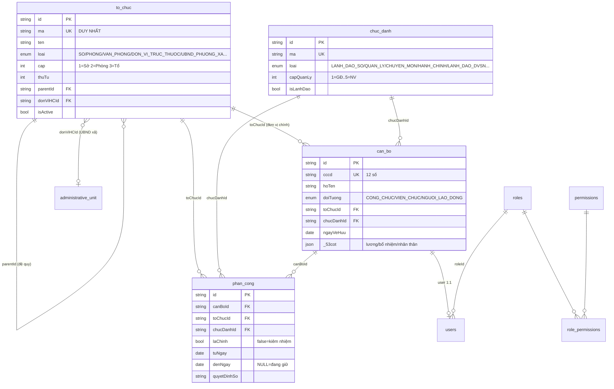
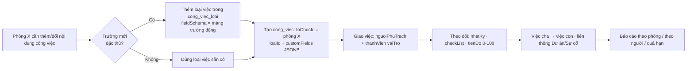
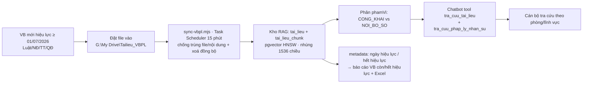
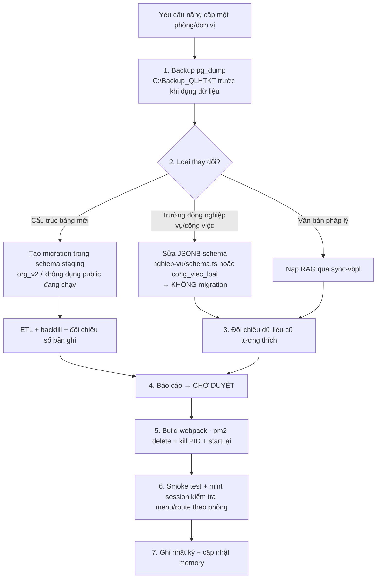

# KẾ HOẠCH CHUẨN HOÁ CSDL & NÂNG CẤP DỮ LIỆU PHÒNG/BAN — ĐƠN VỊ

**Sở Xây dựng tỉnh Quảng Trị · Hệ thống Quản lý Hạ tầng Kỹ thuật (QL-HTKT)**
Phiên bản: 1.0 · Ngày lập: 2026-06-20 · Cập nhật mỗi đợt nâng cấp.
Mục tiêu: lưu lại **toàn bộ kế hoạch, lưu đồ, sơ đồ kết nối CSDL chuẩn hoá** để về sau nâng cấp dữ liệu từng phòng/đơn vị, nâng cấp & cập nhật nội dung công việc từng phòng, và cập nhật **luật/nghị định mới có hiệu lực từ 01/07/2026 trở về sau**.

> Tài liệu liên quan: [`Thiet_Ke_CSDL_To_Chuc_v2.md`](Thiet_Ke_CSDL_To_Chuc_v2.md) (thiết kế lõi tổ chức v2) · [`app/lib/nghiep-vu/schema.ts`](app/lib/nghiep-vu/schema.ts) (52 lĩnh vực động) · [`app/prisma/schema.prisma`](app/prisma/schema.prisma) (schema thực).

---

## 1. NGUYÊN TẮC THIẾT KẾ (bất biến)

Mọi nâng cấp về sau phải tuân thủ 6 nguyên tắc lõi:

1. **Single source of truth** — mỗi sự thật chỉ lưu MỘT nơi, kết nối bằng khoá ngoại (FK), không sao chép cờ tay.
2. **Trạng thái suy ra ĐỘNG** — tên đơn vị, "phòng của ai", "ai là lãnh đạo", "đơn vị còn/không còn" phải suy ra động từ FK `toChucId → to_chuc`, KHÔNG lưu cờ thủ công (vd `conTonTai @deprecated`). Xem [[nguyen-tac-trang-thai-dong]].
3. **Lõi cố định + cánh động** — bảng lõi giữ cột chuẩn; phần đặc thù từng phòng/lĩnh vực để trong **JSONB (`customFields` / `fieldSchema`)** → thêm/bớt trường KHÔNG cần migration.
4. **Cô lập theo `toChucId`** — mỗi phòng chỉ thấy & sửa dữ liệu của phòng mình; lãnh đạo Sở (`isLeadership`) xem tất cả; CCCD/lương luôn che theo quyền.
5. **Liên thông mềm giữa module** — FK mềm (không ràng buộc cứng) giữa Công việc ⇄ Dự án/Lệnh việc/Sự cố/Nghiệp vụ để tránh khoá chéo khi xoá.
6. **Pháp lý là dữ liệu, không phải code** — luật/NĐ/TT lưu trong kho RAG (`tai_lieu`) + bảng tham chiếu pháp lý; cập nhật bằng nhập liệu/đồng bộ, KHÔNG sửa code mỗi lần luật đổi.

---

## 2. SƠ ĐỒ KẾT NỐI CSDL — TỔNG THỂ (4 lớp)

### Quy tắc khoá (mỗi sự thật một nguồn)

| Sự thật | Nguồn DUY NHẤT | KHÔNG dùng |
|---|---|---|
| Đơn vị của cán bộ | `can_bo.toChucId` | `can_bo.phongBan` (text, deprecated) |
| Chức danh của cán bộ | `can_bo.chucDanhId` | `can_bo.chucVu` (text, deprecated) |
| Lịch sử & kiêm nhiệm | `phan_cong` (nhiều dòng, `laChinh`, `denNgay IS NULL`) | — |
| "Là lãnh đạo đơn vị" | phân công đang giữ có `chuc_danh.isLanhDao=true` | cờ tay trên `users` |
| Mã phòng để phân quyền | `to_chuc.ma` (unique) | `users.departmentCode` (bỏ ở v2) |
| Đơn vị của tài khoản | suy từ `users.canBoId → can_bo.toChucId`; TK xã dùng `wardId` | — |
| Tên/tồn tại đơn vị | suy động từ `to_chuc` qua FK | cờ `conTonTai` |

---

## 3. LỚP 1 — TỔ CHỨC & NHÂN SỰ (ERD chi tiết)

**Quy mô lõi (đo trên dữ liệu thật):** ~25 đơn vị · 16 chức danh · 103+ phân công · 145–157 cán bộ · ~198 tài khoản · 4 vai trò. 11 phòng theo **QĐ 331/QĐ-SXD** (xem [[chuc-nang-phong-ban-qd331]]). Trạng thái org_v2: schema `org_v2` đang staging, chờ duyệt cutover (xem [[csdl-to-chuc-v2-staging]]).

---

## 4. LỚP 2 — CÔNG VIỆC PHÒNG/BAN (nâng cấp & cập nhật nội dung công việc)

Đây là **trục để cập nhật/ nâng cấp nội dung công việc từng phòng**. Một lõi `cong_viec` dùng chung cho cả 11 phòng, scope theo `toChucId`; mỗi phòng tự định nghĩa **loại việc + trường động** qua `cong_viec_loai.fieldSchema` (JSONB) → KHÔNG cần migration.

**Bảng & cột chính:** `cong_viec` (maCongViec `CV-YYYY-NNNNNN`, trangThai MOI→DANG_LAM→CHO_DUYET→HOAN_THANH, uuTien, tienDo, congViecChaId cha-con, FK mềm `duAnId/workOrderId/incidentId`), `cong_viec_thanh_vien` (CHU_TRI/PHOI_HOP/THEO_DOI), `cong_viec_nhat_ky` (audit động), `cong_viec_check_list`. Code: [`app/actions/cong-viec.ts`](app/app/actions/cong-viec.ts). Lưu ý vận hành ChunkLoadError/worker zombie khi build, xem [[chunkloaderror-stale-build]] và [[quan-ly-cong-viec-module]].

> **Quy trình chuẩn cập nhật nội dung công việc một phòng:** (1) lấy `toChucId` của phòng từ `to_chuc.ma`; (2) thêm/sửa `cong_viec_loai` cho phòng đó với `fieldSchema` mới; (3) dữ liệu cũ giữ nguyên (trường động ⇒ tương thích ngược); (4) build webpack + `pm2 delete` rồi start lại (tránh zombie cổng 3001).

---

## 5. LỚP 3 — NGHIỆP VỤ ĐỘNG 52 LĨNH VỰC (nâng cấp dữ liệu từng phòng/đơn vị)

`nghiep_vu_ban_ghi` là kho **nhập liệu CSDL chuyên ngành** cho **52 lĩnh vực / 11 phòng**, schema trường động tại [`app/lib/nghiep-vu/schema.ts`](app/lib/nghiep-vu/schema.ts). Key `linhVuc` = đường dẫn sau `/dashboard/` (vd `phong-htkt/cap-nuoc`). Cô lập theo `toChucId`. Xem [[nghiep-vu-ho-so-dong-2026]].

| Phòng (prefix linhVuc) | Số lĩnh vực | Ví dụ lĩnh vực |
|---|---|---|
| `phong-htkt/` Hạ tầng kỹ thuật | 8 | cap-nuoc, thoat-nuoc, cay-xanh, chieu-sang, nghia-trang, giao-thong-do-thi, khong-gian-ngam, su-dung-chung |
| `phong-kt-vl/` Kinh tế & VLXD | 4 | dinh-muc-don-gia, cong-bo-gia-vlxd, tham-dinh-du-toan-qh, quan-ly-vlxd-khoang-san |
| `phong-ptdt/` Phát triển đô thị | 5 | chuong-trinh-ptdt, phan-loai-do-thi, do-thi-thong-minh, tham-dinh-htkt-khu-do-thi, csdl-ptdt |
| `phong-kh-tc/` Kế hoạch – Tài chính | 5 | ke-hoach-phat-trien, dau-thau, ke-hoach-von, tai-chinh-ke-toan, thong-ke |
| `phong-clct/` QL chất lượng CT giao thông | 5 | tham-dinh-thiet-ke, kiem-tra-nghiem-thu, chat-luong-an-toan, bao-tri-cong-trinh, giam-dinh-dinh-muc |
| `phong-qlkcht/` QL kết cấu HT giao thông | 5 | ket-cau-ha-tang, an-toan-giao-thong, cap-phep-thi-cong, ben-xe-cang-ben, pha-do-nong-thon-moi |
| `phong-qlhd-xd/` QL hoạt động xây dựng | 5 | cap-phep-xay-dung, trat-tu-xay-dung, tham-dinh-du-an, chung-chi-nha-thau, thi-nghiem-chuyen-nganh |
| `phong-ql-vt/` Quản lý vận tải | 5 | dang-kiem-duong-thuy, dao-tao-sat-hach, quan-ly-van-tai, van-tai-cong-cong, htx-gtvt |
| `phong-qh-kt/` Quy hoạch – Kiến trúc | 5 | csdl-quy-hoach, tham-dinh-quy-hoach, thiet-ke-do-thi, quy-che-kien-truc, chung-chi-kien-truc |
| `phong-ql-nha/` QL nhà & thị trường BĐS | 5 | phat-trien-nha-o, nha-o-xa-hoi, dinh-gia-nha, thi-truong-bds, he-thong-thong-tin |

**Cách nâng cấp dữ liệu một phòng/đơn vị:** thêm key lĩnh vực mới hoặc thêm `NvField` vào `NGHIEP_VU_SCHEMAS` (text/number/date/select/textarea) → giao diện & lưu trữ tự cập nhật, không migration. Tài sản hiện trường có GIS riêng (MapLibre, PostGIS) ở các bảng chuyên dụng (DenChieuSang, CayXanhDuong, CongThoatNuoc, OngCapNuoc…). Việc nghiệp vụ có thể liên thông sang `cong_viec` bằng FK mềm.

---

## 6. LỚP 4 — PHÁP LÝ: LUẬT/NĐ/TT MỚI HIỆU LỰC TỪ 01/07/2026

**Pháp lý là DỮ LIỆU.** Khi có văn bản mới hiệu lực 01/07/2026 trở đi, cập nhật bằng đồng bộ/nhập liệu — KHÔNG sửa code.

**Hạ tầng sẵn có:** kho RAG tự host (pgvector 0.8.0 cho PG16) — [[rag-tra-cuu-tai-lieu-2026]]; đồng bộ 2 chiều thư mục ⇄ kho — [[sync-vbpl-thu-muc-2026]]; bảng `RoadLegalReference` cho tham chiếu pháp lý nghiệp vụ; KB pháp lý nhân sự — [[canh-bao-nhan-su-2026]].

**Quy trình cập nhật một văn bản 01/07/2026:**
1. Bỏ file VB vào `G:\My Drive\Tailieu_VBPL` (hoặc upload tại `/dashboard/tai-lieu`).
2. Đặt `metadata` ngày hiệu lực = `2026-07-01`, ngày hết hiệu lực của VB cũ bị thay thế.
3. `sync-vbpl.mjs` tự nạp + nhúng vector; báo cáo hiệu lực tự đánh dấu VB cũ hết hiệu lực.
4. Cập nhật enum đối tượng/chế độ trong nhân sự nếu luật đổi căn bản (vd Luật CBCC 2025 / NĐ 170/2025 đã tham chiếu trong `DoiTuongNhanSu`).
5. Chatbot trích dẫn VB còn hiệu lực, kèm `phamVi`.

> **Lưu ý mốc 01/07/2026:** một số luật/NĐ về tổ chức chính quyền địa phương, cán bộ công chức, xây dựng, quy hoạch đô thị có hiệu lực mốc này. Hệ thống đã dùng FK động (`toChucId`) và quê quán theo NQ 1680, nghỉ hưu NĐ 135 — khi VB mới hiệu lực chỉ cần nạp vào RAG + chỉnh danh mục, KHÔNG đổi cấu trúc bảng.

---

## 7. LƯU ĐỒ QUY TRÌNH NÂNG CẤP TỔNG QUÁT (an toàn, lặp lại mỗi đợt)

**Checklist vận hành bắt buộc:**
- Backup trước mọi thao tác ghi (pg_dump 2:00 đêm tự động — [[backup-va-bim-2026]]; ⚠️ theo dõi dung lượng ổ C:).
- Không drop/đổi bảng `public` cho tới khi duyệt kết quả staging `org_v2`.
- Build **webpack** (không turbopack), `pm2 delete` + kill PID giữ cổng 3001 + start lại để tránh worker zombie ([[chunkloaderror-stale-build]]).
- Phân quyền: lãnh đạo Sở xem tất cả qua `isLeadership`; CCCD/lương luôn che ([[lanh-dao-so-xem-toan-bo]], [[quyen-quan-ly-can-bo]]).
- Menu thật là `sidebar-new.tsx` (dạng nhóm), không phải `sidebar.tsx` ([[sidebar-thuc-te-2026]]).

---

## 8. LỘ TRÌNH NÂNG CẤP (Roadmap)

| Giai đoạn | Nội dung | Trạng thái | Phụ thuộc |
|---|---|---|---|
| **GĐ 0** | Backup + thiết kế org_v2 staging | ✅ Có backup, schema staging | — |
| **GĐ 1** | Cutover org_v2: bỏ cột `departmentCode` (GIỮ `isDepartmentLeader` theo chốt 19/6), backfill phan_cong đủ 145 CB | ⏳ Chờ duyệt bước cuối — 3/7/26 đã: (a) re-sync staging org_v2 khớp 100% public (193 TK, backfill phan_cong 103→145); (b) refactor code XONG: `deptCodeFromToChucMa()` suy động từ `to_chuc.ma`, không còn code đọc cột `users.departmentCode`. Cutover còn lại CHỈ là migration xoá cột thừa (`users.departmentCode`, `can_bo.chucVu/phongBan`) + prisma generate | — |
| **GĐ 2** | Hoàn thiện UI module Công việc 11 phòng (CSDL & API đã có) | ✅ Xong (danh sách + Kanban + Lịch + Gantt, tìm kiếm, CRUD, bình luận, thành viên; smoke 81 trang OK 3/7/26) | org_v2 |
| **GĐ 3** | Mở rộng 52 lĩnh vực nghiệp vụ động + nhập liệu thật từng phòng | 🔄 Đang nhập | schema.ts |
| **GĐ 4** | Liên thông Công việc ⇄ GIS hiện trường ⇄ Nghiệp vụ (FK mềm) | 🔜 | GĐ 2,3 |
| **GĐ 5** | Cập nhật pháp lý 01/07/2026: nạp RAG + đánh dấu hiệu lực + chỉnh danh mục | 🔁 Liên tục | sync-vbpl |
| **GĐ 6** | BIM/AIM 6 lớp cho hạ tầng (thiết kế đã có) | 🔜 | dung lượng ổ |

---

## 9. CHỈ MỤC CÁC ĐIỂM NEO TRONG MÃ NGUỒN

| Thành phần | Đường dẫn |
|---|---|
| Schema CSDL thực | [`app/prisma/schema.prisma`](app/prisma/schema.prisma) (3145 dòng) |
| Thiết kế org v2 | [`Thiet_Ke_CSDL_To_Chuc_v2.md`](Thiet_Ke_CSDL_To_Chuc_v2.md) |
| Trường động 52 lĩnh vực | [`app/lib/nghiep-vu/schema.ts`](app/lib/nghiep-vu/schema.ts) |
| Action công việc | [`app/app/actions/cong-viec.ts`](app/app/actions/cong-viec.ts) |
| Action nghiệp vụ | [`app/app/actions/nghiep-vu.ts`](app/app/actions/nghiep-vu.ts) |
| RAG | [`app/lib/rag/`](app/lib/rag/) · `sync-vbpl.mjs` |
| Phân quyền | [`app/lib/auth.ts`](app/lib/auth.ts) · `permissions.ts` · `sidebar-new.tsx` |
| Backup/BIM | `C:\Backup_QLHTKT` · `Thiet_Ke_Module_BIM_AIM_Theo_Phap_Ly_VN.md` |

---
*Tài liệu sống — cập nhật mỗi đợt nâng cấp; mọi thay đổi cấu trúc phải qua quy trình mục 7.*
