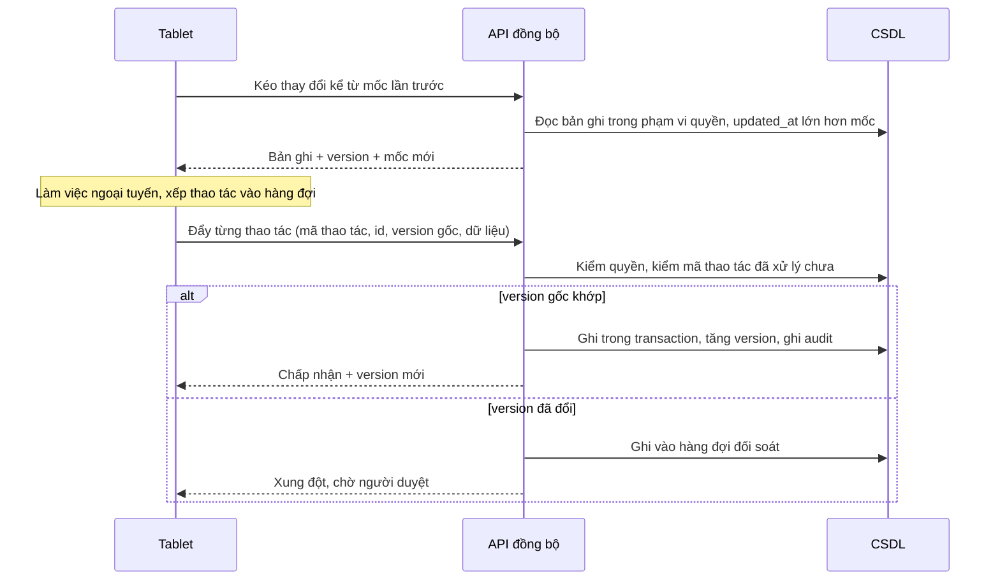

# DATA_SYNC_DESIGN — Thiết kế đồng bộ tablet và ngoại tuyến

Trạng thái: PROPOSED. Hệ thống hiện không có thành phần ngoại tuyến nào: không service worker, không IndexedDB, không manifest (VERIFIED bằng grep ngày 13/11/2026). Tài liệu này là thiết kế để duyệt, chưa có mã.

## Điều đã có và dùng lại được

| Thành phần | Hiện trạng |
|---|---|
| Định danh | khoá chính `text` toàn hệ thống: tablet tự sinh id được, không cần ánh xạ id tạm |
| Mốc thay đổi | `updatedAt` / `updated_at` có ở hầu hết bảng nghiệp vụ |
| Xoá mềm | `deletedAt` / `deleted_at` ở `htkt_doi_tuong`, `nghiep_vu_ban_ghi`, `cong_viec`, `tai_lieu`, `cchn_*`, `httt_*` |
| Phân quyền | `users` → `roles` → `permissions`; phạm vi theo `toChucId` và `wardId` |
| Audit | `lib/audit.ts` → `audit_logs` |
| Bản đồ | MapLibre, GeoJSON nén theo ranh tỉnh |

## Điều phải tạo mới

Cột `version`, khoá idempotency cho thao tác ghi, bảng thiết bị, bảng nhật ký đồng bộ, hàng đợi đối soát, lớp lưu trữ phía tablet.

## Phạm vi đợt đầu

Chỉ ba loại bản ghi dùng ngoài hiện trường: đối tượng HTKT (`htkt_doi_tuong`), bản ghi nghiệp vụ (`nghiep_vu_ban_ghi`), công việc (`cong_viec`). Danh mục (`administrative_units`, `streets`, `to_chuc`) chỉ tải xuống, không sửa trên tablet. Dữ liệu nhân sự, lương, CCCD không đưa xuống tablet.

## Mô hình

## Quy tắc

1. **Đồng bộ tăng dần.** Kéo theo mốc `updated_at` do máy chủ cấp, kèm cả bản ghi đã xoá mềm. Tablet không dùng đồng hồ của mình làm mốc.
2. **Hàng đợi ngoại tuyến.** Mỗi thao tác có mã do tablet sinh một lần. Gửi lại cùng mã thì máy chủ trả kết quả cũ, không ghi lần hai.
3. **Xung đột phiên bản.** Thao tác mang `version` gốc. Lệch thì không ghi, không tự trộn; đưa vào `doi_soat_hang_doi` với cả dữ liệu đề xuất và dữ liệu hiện tại.
4. **Không ghi đè bản ghi chính thức.** Bản ghi ở trạng thái đã duyệt (`DA_DUYET` và tương đương) chỉ nhận đề xuất sửa qua hàng đợi, kể cả khi `version` khớp.
5. **Phân quyền kiểm ở máy chủ, lúc đồng bộ.** Kéo: chỉ trả bản ghi thuộc `toChucId` / `wardId` của tài khoản. Đẩy: kiểm lại quyền tại thời điểm đẩy, không tin quyền lúc tablet tạo thao tác.
6. **Thiết bị thất lạc.** Mỗi tablet đăng ký thành một dòng thiết bị gắn tài khoản. Thu hồi thiết bị thì máy chủ từ chối mọi yêu cầu của nó và báo ứng dụng xoá dữ liệu cục bộ ở lần kết nối kế tiếp. Dữ liệu cục bộ có hạn dùng ngoại tuyến; quá hạn phải đăng nhập lại.
7. **Nhật ký.** Mỗi thao tác đẩy lưu trạng thái (chờ / chấp nhận / xung đột / lỗi), thông báo lỗi, thiết bị, thời điểm.

## Bảng dự kiến (bước E9)

| Bảng | Cột chính |
|---|---|
| `thiet_bi` | `id`, `user_id`, `ten`, `trang_thai` (hoat_dong / thu_hoi), `dang_ky_luc`, `lan_cuoi_dong_bo`, `thu_hoi_luc`, `thu_hoi_boi_id` |
| `dong_bo_thao_tac` | `id` (mã thao tác từ tablet, khoá chính để chống ghi lặp), `thiet_bi_id`, `user_id`, `bang`, `ban_ghi_id`, `loai` (tao / sua / xoa_mem), `version_goc`, `du_lieu` jsonb, `trang_thai`, `loi`, `nhan_luc`, `xu_ly_luc` |
| `doi_soat_hang_doi` | xem `SCHEMA_EVOLUTION_PLAN.md`, E2 |

## Câu hỏi cần người dùng quyết

1. Tablet là ứng dụng web cài được (PWA) hay ứng dụng riêng. Đề xuất PWA: dùng lại mã Next.js và MapLibre hiện có.
2. Thời hạn dùng ngoại tuyến tối đa trước khi buộc đăng nhập lại.
3. Ảnh hiện trường lưu ở đâu và giới hạn dung lượng; ổ C: của VPS từng thiếu chỗ.
4. Đăng nhập trên tablet vẫn bằng CCCD hay cần phương thức khác; CCCD không được lưu cục bộ ở dạng đọc được.

## Rủi ro

| Rủi ro | Mức |
|---|---|
| Dữ liệu trên thiết bị mất không được mã hoá | HIGH |
| Đường ghi cũ trên web không tăng `version`, làm sai kiểm tra xung đột | HIGH |
| Lưu lượng đồng bộ trên VPS 6 GB chạy chung production | MEDIUM |
| Trigger trên `htkt_doi_tuong` thay đổi dữ liệu sau khi ghi, làm tablet lệch với máy chủ | MEDIUM, UNKNOWN cho đến khi đọc trigger |
