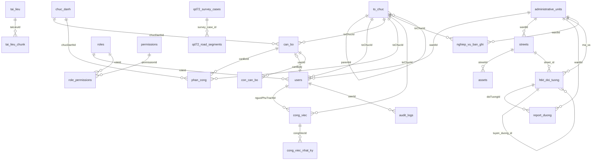

# ENTITY_RELATIONSHIP_MAP — Bản đồ quan hệ dữ liệu

Nguồn: `pg_constraint` của CSDL thật, giao dịch READ ONLY, ngày 13/11/2026 (VERIFIED). 248 khoá ngoại cứng. Khoá ngoại mềm xem `EXISTING_DATA_INVENTORY.md`.

## Sơ đồ lõi

Chỉ vẽ các thực thể chủ và quan hệ chính; quan hệ đầy đủ ở các bảng bên dưới.

Tên cột trên sơ đồ lấy từ khoá ngoại thật ở các bảng dưới; riêng nhánh `administrative_units → htkt_doi_tuong` và `qd72_*` ghi theo tên cột, xem bảng chi tiết để biết tên ràng buộc.

## Thực thể trung tâm (xếp theo số khoá ngoại trỏ vào)

| Bảng đích | Số FK trỏ vào | Số bảng nguồn |
|---|---:|---:|
| `users` | 56 | 47 |
| `administrative_units` | 40 | 40 |
| `qd72_survey_cases` | 19 | 19 |
| `to_chuc` | 15 | 15 |
| `streets` | 13 | 13 |
| `can_bo` | 10 | 10 |
| `htkt_doi_tuong` | 8 | 8 |
| `asset_types` | 4 | 4 |
| `cong_viec` | 4 | 4 |
| `assets` | 4 | 4 |
| `qd72_utility_owners` | 4 | 4 |
| `road_connection_applications` | 4 | 4 |
| `ds_du_an_gpmb` | 3 | 3 |
| `httt_dinh_danh` | 3 | 3 |
| `qd72_water_sources` | 3 | 3 |
| `qd72_road_segments` | 3 | 3 |
| `bim_model_versions` | 2 | 2 |
| `bim_models` | 2 | 2 |
| `chuc_danh` | 2 | 2 |
| `cchn_ho_so` | 2 | 2 |

## Chi tiết khoá ngoại theo bảng đích

### `users` (56)

| Bảng nguồn | Cột | Khi xoá |
|---|---|---|
| `asset_import_batches` | `importedById` | RESTRICT |
| `audit_logs` | `userId` | RESTRICT |
| `can_bo` | `userId` | SET NULL |
| `cchn_ho_so` | `created_by_id` | SET NULL |
| `cchn_lich_su` | `nguoi_id` | SET NULL |
| `chatbot_logs` | `userId` | RESTRICT |
| `cong_viec` | `nguoiGiaoId` | SET NULL |
| `cong_viec` | `nguoiPhuTrachId` | SET NULL |
| `cong_viec` | `createdById` | RESTRICT |
| `cong_viec_nhat_ky` | `userId` | SET NULL |
| `cong_viec_thanh_vien` | `userId` | RESTRICT |
| `htkt_doi_tuong` | `created_by_id` | SET NULL |
| `htkt_doi_tuong` | `updated_by_id` | SET NULL |
| `httt_dong_bo_log` | `nguoi_id` | SET NULL |
| `httt_nang_luc_ca_nhan` | `created_by_id` | SET NULL |
| `httt_nang_luc_to_chuc` | `created_by_id` | SET NULL |
| `incidents` | `reportedById` | SET NULL |
| `incidents` | `resolvedById` | SET NULL |
| `inspections` | `inspectorId` | RESTRICT |
| `lich_ca_nhan` | `userId` | RESTRICT |
| `nghiep_vu_ban_ghi` | `createdById` | SET NULL |
| `office_annual_evaluations` | `createdById` | SET NULL |
| `office_discipline_records` | `createdById` | SET NULL |
| `office_generated_documents` | `createdById` | SET NULL |
| `office_reward_records` | `createdById` | SET NULL |
| `office_salary_history` | `createdById` | SET NULL |
| `office_salary_review_cases` | `nguoiRaSoatId` | SET NULL |
| `office_salary_review_cases` | `nguoiDuyetId` | SET NULL |
| `office_salary_review_cases` | `createdById` | SET NULL |
| `office_work_history` | `createdById` | SET NULL |
| `qd72_attachments` | `uploaded_by_id` | SET NULL |
| `qd72_clearance_measurements` | `created_by_id` | SET NULL |
| `qd72_comments` | `nguoi_id` | SET NULL |
| `qd72_overhead_utility_lines` | `created_by_id` | SET NULL |
| `qd72_renovation_plans` | `created_by_id` | SET NULL |
| `qd72_road_segments` | `created_by_id` | SET NULL |
| `qd72_survey_cases` | `updated_by_id` | SET NULL |
| `qd72_survey_cases` | `verified_by_id` | SET NULL |
| `qd72_survey_cases` | `created_by_id` | SET NULL |
| `qd72_undergrounding_proposals` | `created_by_id` | SET NULL |
| `qd72_urban_areas` | `created_by_id` | SET NULL |
| `qd72_verification_records` | `created_by_id` | SET NULL |
| `qd72_water_sources` | `created_by_id` | SET NULL |
| `qd72_water_test_results` | `created_by_id` | SET NULL |
| `qd72_workflow_history` | `nguoi_thuc_hien_id` | SET NULL |
| `report_bai_do_xe` | `createdById` | RESTRICT |
| `report_cap_nuoc` | `createdById` | RESTRICT |
| `report_cay_xanh` | `createdById` | RESTRICT |
| `report_cong_vien` | `createdById` | RESTRICT |
| `report_dien_cs` | `createdById` | RESTRICT |
| `report_duong` | `createdById` | RESTRICT |
| `report_thoat_nuoc` | `createdById` | RESTRICT |
| `thanh_tich_con` | `createdById` | SET NULL |
| `ward_reports` | `createdById` | RESTRICT |
| `work_orders` | `createdById` | RESTRICT |
| `work_orders` | `assignedToId` | SET NULL |

### `administrative_units` (40)

| Bảng nguồn | Cột | Khi xoá |
|---|---|---|
| `administrative_units` | `parentId` | SET NULL |
| `assets` | `wardId` | SET NULL |
| `cap_vien_thong` | `wardId` | SET NULL |
| `cay_xanh_duong` | `wardId` | SET NULL |
| `cong_thoat_nuoc` | `wardId` | SET NULL |
| `den_chieu_sang` | `wardId` | SET NULL |
| `ds_du_an_gpmb` | `wardId` | SET NULL |
| `ho_ga` | `wardId` | SET NULL |
| `htkt_doi_tuong` | `ma_xa` | NO ACTION |
| `incidents` | `wardId` | SET NULL |
| `lanh_dao_xa` | `wardId` | CASCADE |
| `nghiep_vu_ban_ghi` | `wardId` | SET NULL |
| `nha_may_xu_ly_nuoc_thai` | `wardId` | SET NULL |
| `ong_cap_nuoc` | `wardId` | SET NULL |
| `projects` | `wardId` | SET NULL |
| `qd72_administrative_unit_assignments` | `don_vi_hanh_chinh_id` | CASCADE |
| `qd72_overhead_utility_lines` | `don_vi_hanh_chinh_id` | RESTRICT |
| `qd72_renovation_plans` | `don_vi_hanh_chinh_id` | RESTRICT |
| `qd72_road_segments` | `don_vi_hanh_chinh_id` | RESTRICT |
| `qd72_shared_technical_infrastructure` | `don_vi_hanh_chinh_id` | RESTRICT |
| `qd72_survey_cases` | `don_vi_hanh_chinh_id` | RESTRICT |
| `qd72_urban_areas` | `don_vi_hanh_chinh_id` | RESTRICT |
| `qd72_water_sources` | `don_vi_hanh_chinh_id` | RESTRICT |
| `report_bai_do_xe` | `wardId` | RESTRICT |
| `report_cap_nuoc` | `wardId` | RESTRICT |
| `report_cay_xanh` | `wardId` | RESTRICT |
| `report_cong_vien` | `wardId` | RESTRICT |
| `report_dien_cs` | `wardId` | RESTRICT |
| `report_duong` | `wardId` | RESTRICT |
| `report_thoat_nuoc` | `wardId` | RESTRICT |
| `streets` | `wardId` | SET NULL |
| `to_chuc` | `donViHCId` | SET NULL |
| `tram_bom` | `wardId` | SET NULL |
| `tuyen_mang_luoi` | `wardId` | SET NULL |
| `users` | `wardId` | SET NULL |
| `van_cap_nuoc` | `wardId` | SET NULL |
| `via_he` | `wardId` | SET NULL |
| `ward_gis_length` | `wardId` | CASCADE |
| `ward_khai_bao` | `wardId` | CASCADE |
| `ward_reports` | `wardId` | SET NULL |

### `qd72_survey_cases` (19)

| Bảng nguồn | Cột | Khi xoá |
|---|---|---|
| `qd72_attachments` | `survey_case_id` | CASCADE |
| `qd72_clearance_measurements` | `survey_case_id` | CASCADE |
| `qd72_comments` | `survey_case_id` | CASCADE |
| `qd72_fire_hydrants` | `survey_case_id` | CASCADE |
| `qd72_fire_parking_areas` | `survey_case_id` | CASCADE |
| `qd72_overhead_utility_lines` | `survey_case_id` | CASCADE |
| `qd72_passing_bays` | `survey_case_id` | CASCADE |
| `qd72_public_lighting_assets` | `survey_case_id` | CASCADE |
| `qd72_renovation_plans` | `survey_case_id` | CASCADE |
| `qd72_road_obstacles` | `survey_case_id` | CASCADE |
| `qd72_road_segments` | `survey_case_id` | CASCADE |
| `qd72_shared_technical_infrastructure` | `survey_case_id` | CASCADE |
| `qd72_undergrounding_proposals` | `survey_case_id` | CASCADE |
| `qd72_urban_areas` | `survey_case_id` | CASCADE |
| `qd72_utility_crossings` | `survey_case_id` | CASCADE |
| `qd72_utility_poles` | `survey_case_id` | CASCADE |
| `qd72_verification_records` | `survey_case_id` | CASCADE |
| `qd72_water_sources` | `survey_case_id` | CASCADE |
| `qd72_workflow_history` | `survey_case_id` | CASCADE |

### `to_chuc` (15)

| Bảng nguồn | Cột | Khi xoá |
|---|---|---|
| `can_bo` | `toChucId` | SET NULL |
| `cchn_ho_so` | `to_chuc_id` | SET NULL |
| `cong_viec` | `toChucId` | RESTRICT |
| `cong_viec_loai` | `toChucId` | SET NULL |
| `ds_du_an_gpmb` | `toChucId` | SET NULL |
| `httt_nang_luc_ca_nhan` | `to_chuc_id` | SET NULL |
| `httt_nang_luc_to_chuc` | `to_chuc_id` | SET NULL |
| `lich_ca_nhan` | `toChucId` | SET NULL |
| `nghiep_vu_ban_ghi` | `toChucId` | SET NULL |
| `phan_cong` | `toChucId` | RESTRICT |
| `qd72_administrative_unit_assignments` | `to_chuc_id` | CASCADE |
| `qd72_survey_cases` | `to_chuc_id` | SET NULL |
| `qd72_utility_owners` | `to_chuc_id` | SET NULL |
| `to_chuc` | `parentId` | SET NULL |
| `users` | `toChucId` | SET NULL |

### `streets` (13)

| Bảng nguồn | Cột | Khi xoá |
|---|---|---|
| `assets` | `streetId` | SET NULL |
| `cap_vien_thong` | `streetId` | RESTRICT |
| `cay_xanh_duong` | `streetId` | RESTRICT |
| `cong_thoat_nuoc` | `streetId` | RESTRICT |
| `den_chieu_sang` | `streetId` | RESTRICT |
| `doan_tuyen_cong` | `streetId` | RESTRICT |
| `doan_tuyen_ong` | `streetId` | RESTRICT |
| `ho_ga` | `streetId` | SET NULL |
| `htkt_doi_tuong` | `street_id` | SET NULL |
| `ong_cap_nuoc` | `streetId` | RESTRICT |
| `tram_bom` | `streetId` | SET NULL |
| `van_cap_nuoc` | `streetId` | SET NULL |
| `via_he` | `streetId` | RESTRICT |

### `can_bo` (10)

| Bảng nguồn | Cột | Khi xoá |
|---|---|---|
| `con_can_bo` | `canBoId` | CASCADE |
| `office_annual_evaluations` | `canBoId` | CASCADE |
| `office_discipline_records` | `canBoId` | CASCADE |
| `office_generated_documents` | `canBoId` | SET NULL |
| `office_leave_requests` | `canBoId` | CASCADE |
| `office_reward_records` | `canBoId` | CASCADE |
| `office_salary_history` | `canBoId` | CASCADE |
| `office_salary_review_cases` | `canBoId` | CASCADE |
| `office_work_history` | `canBoId` | CASCADE |
| `phan_cong` | `canBoId` | CASCADE |

### `htkt_doi_tuong` (8)

| Bảng nguồn | Cột | Khi xoá |
|---|---|---|
| `htkt_doi_tuong` | `tuyen_duong_id` | SET NULL |
| `report_bai_do_xe` | `doiTuongId` | SET NULL |
| `report_cap_nuoc` | `doiTuongId` | SET NULL |
| `report_cay_xanh` | `doiTuongId` | SET NULL |
| `report_cong_vien` | `doiTuongId` | SET NULL |
| `report_dien_cs` | `doiTuongId` | SET NULL |
| `report_duong` | `doiTuongId` | SET NULL |
| `report_thoat_nuoc` | `doiTuongId` | SET NULL |

### `asset_types` (4)

| Bảng nguồn | Cột | Khi xoá |
|---|---|---|
| `asset_import_batches` | `assetTypeId` | RESTRICT |
| `assets` | `assetTypeId` | RESTRICT |
| `inspection_templates` | `assetTypeId` | SET NULL |
| `maintenance_schedules` | `assetTypeId` | SET NULL |

### `cong_viec` (4)

| Bảng nguồn | Cột | Khi xoá |
|---|---|---|
| `cong_viec` | `congViecChaId` | SET NULL |
| `cong_viec_check_list` | `congViecId` | CASCADE |
| `cong_viec_nhat_ky` | `congViecId` | CASCADE |
| `cong_viec_thanh_vien` | `congViecId` | CASCADE |

### `assets` (4)

| Bảng nguồn | Cột | Khi xoá |
|---|---|---|
| `incidents` | `assetId` | SET NULL |
| `inspections` | `assetId` | RESTRICT |
| `maintenance_schedules` | `assetId` | SET NULL |
| `work_orders` | `assetId` | SET NULL |

### `qd72_utility_owners` (4)

| Bảng nguồn | Cột | Khi xoá |
|---|---|---|
| `qd72_administrative_unit_assignments` | `owner_id` | SET NULL |
| `qd72_overhead_utility_lines` | `owner_id` | SET NULL |
| `qd72_public_lighting_assets` | `owner_id` | SET NULL |
| `qd72_utility_poles` | `owner_id` | SET NULL |

### `road_connection_applications` (4)

| Bảng nguồn | Cột | Khi xoá |
|---|---|---|
| `road_connection_inspections` | `applicationId` | CASCADE |
| `road_connection_locations` | `applicationId` | CASCADE |
| `road_connection_permits` | `applicationId` | CASCADE |
| `road_permit_status_logs` | `connectionApplicationId` | CASCADE |

### `ds_du_an_gpmb` (3)

| Bảng nguồn | Cột | Khi xoá |
|---|---|---|
| `ds_du_an_thanh_phan` | `duAnGpmbId` | CASCADE |
| `ds_ke_hoach_von` | `duAnGpmbId` | CASCADE |
| `ds_lien_he` | `duAnGpmbId` | SET NULL |

### `httt_dinh_danh` (3)

| Bảng nguồn | Cột | Khi xoá |
|---|---|---|
| `httt_dong_bo_log` | `dinh_danh_id` | CASCADE |
| `httt_nang_luc_ca_nhan` | `dinh_danh_id` | SET NULL |
| `httt_nang_luc_to_chuc` | `dinh_danh_id` | SET NULL |

### `qd72_water_sources` (3)

| Bảng nguồn | Cột | Khi xoá |
|---|---|---|
| `qd72_fire_hydrants` | `water_source_id` | SET NULL |
| `qd72_water_intake_points` | `water_source_id` | CASCADE |
| `qd72_water_test_results` | `water_source_id` | CASCADE |

### `qd72_road_segments` (3)

| Bảng nguồn | Cột | Khi xoá |
|---|---|---|
| `qd72_passing_bays` | `road_segment_id` | SET NULL |
| `qd72_road_obstacles` | `road_segment_id` | SET NULL |
| `qd72_utility_crossings` | `road_segment_id` | SET NULL |

### `bim_model_versions` (2)

| Bảng nguồn | Cột | Khi xoá |
|---|---|---|
| `bim_consistency_reviews` | `versionId` | CASCADE |
| `bim_files` | `versionId` | CASCADE |

### `bim_models` (2)

| Bảng nguồn | Cột | Khi xoá |
|---|---|---|
| `bim_model_versions` | `modelId` | CASCADE |
| `bim_view_permissions` | `modelId` | CASCADE |

### `chuc_danh` (2)

| Bảng nguồn | Cột | Khi xoá |
|---|---|---|
| `can_bo` | `chucDanhId` | SET NULL |
| `phan_cong` | `chucDanhId` | RESTRICT |

### `cchn_ho_so` (2)

| Bảng nguồn | Cột | Khi xoá |
|---|---|---|
| `cchn_kinh_nghiem` | `ho_so_id` | CASCADE |
| `cchn_lich_su` | `ho_so_id` | CASCADE |

### `ho_ga` (2)

| Bảng nguồn | Cột | Khi xoá |
|---|---|---|
| `cong_thoat_nuoc` | `hoGaDauId` | SET NULL |
| `cong_thoat_nuoc` | `hoGaCuoiId` | SET NULL |

### `tuyen_mang_luoi` (2)

| Bảng nguồn | Cột | Khi xoá |
|---|---|---|
| `doan_tuyen_cong` | `tuyenId` | RESTRICT |
| `doan_tuyen_ong` | `tuyenId` | RESTRICT |

### `inspections` (2)

| Bảng nguồn | Cột | Khi xoá |
|---|---|---|
| `incidents` | `inspectionId` | SET NULL |
| `inspection_results` | `inspectionId` | RESTRICT |

### `inspection_templates` (2)

| Bảng nguồn | Cột | Khi xoá |
|---|---|---|
| `inspection_template_items` | `templateId` | RESTRICT |
| `inspections` | `templateId` | RESTRICT |

### `material_categories` (2)

| Bảng nguồn | Cột | Khi xoá |
|---|---|---|
| `material_categories` | `parentId` | SET NULL |
| `materials` | `categoryId` | RESTRICT |

### `overtime_timesheets` (2)

| Bảng nguồn | Cột | Khi xoá |
|---|---|---|
| `overtime_entries` | `timesheetId` | CASCADE |
| `overtime_signatures` | `timesheetId` | CASCADE |

### `oversized_vehicle_permits` (2)

| Bảng nguồn | Cột | Khi xoá |
|---|---|---|
| `permit_routes` | `permitId` | CASCADE |
| `road_permit_status_logs` | `oversizedPermitId` | CASCADE |

### `executing_units` (2)

| Bảng nguồn | Cột | Khi xoá |
|---|---|---|
| `projects` | `executingUnitId` | SET NULL |
| `work_orders` | `executingUnitId` | SET NULL |

### `qd72_legal_documents` (2)

| Bảng nguồn | Cột | Khi xoá |
|---|---|---|
| `qd72_legal_documents` | `sua_doi_cho_id` | SET NULL |
| `qd72_technical_rules` | `legal_document_id` | RESTRICT |

### `qd72_overhead_utility_lines` (2)

| Bảng nguồn | Cột | Khi xoá |
|---|---|---|
| `qd72_undergrounding_proposals` | `line_id` | SET NULL |
| `qd72_utility_crossings` | `line_id` | SET NULL |

### `roles` (2)

| Bảng nguồn | Cột | Khi xoá |
|---|---|---|
| `role_permissions` | `roleId` | RESTRICT |
| `users` | `roleId` | RESTRICT |

### `materials` (2)

| Bảng nguồn | Cột | Khi xoá |
|---|---|---|
| `stock_transactions` | `materialId` | RESTRICT |
| `work_order_materials` | `materialId` | SET NULL |

### `nha_may_xu_ly_nuoc_thai` (2)

| Bảng nguồn | Cột | Khi xoá |
|---|---|---|
| `tram_bom` | `nhaMayXuLyId` | SET NULL |
| `tuyen_mang_luoi` | `nhaMayXuLyId` | SET NULL |

### `bim_files` (1)

| Bảng nguồn | Cột | Khi xoá |
|---|---|---|
| `bim_validation_checks` | `fileId` | CASCADE |

### `httt_nang_luc_ca_nhan` (1)

| Bảng nguồn | Cột | Khi xoá |
|---|---|---|
| `cchn_ho_so` | `nang_luc_ca_nhan_id` | SET NULL |

### `cong_viec_loai` (1)

| Bảng nguồn | Cột | Khi xoá |
|---|---|---|
| `cong_viec` | `loaiId` | SET NULL |

### `inspection_template_items` (1)

| Bảng nguồn | Cột | Khi xoá |
|---|---|---|
| `inspection_results` | `itemId` | RESTRICT |

### `office_salary_review_cases` (1)

| Bảng nguồn | Cột | Khi xoá |
|---|---|---|
| `office_generated_documents` | `reviewCaseId` | SET NULL |

### `office_leave_requests` (1)

| Bảng nguồn | Cột | Khi xoá |
|---|---|---|
| `office_leave_signatures` | `leaveRequestId` | CASCADE |

### `office_emulation_movements` (1)

| Bảng nguồn | Cột | Khi xoá |
|---|---|---|
| `office_reward_records` | `movementId` | SET NULL |

### `office_reward_titles` (1)

| Bảng nguồn | Cột | Khi xoá |
|---|---|---|
| `office_reward_records` | `rewardTitleId` | SET NULL |

### `permit_vehicles` (1)

| Bảng nguồn | Cột | Khi xoá |
|---|---|---|
| `oversized_vehicle_permits` | `vehicleId` | SET NULL |

### `projects` (1)

| Bảng nguồn | Cột | Khi xoá |
|---|---|---|
| `project_milestones` | `projectId` | RESTRICT |

### `qd72_renovation_plans` (1)

| Bảng nguồn | Cột | Khi xoá |
|---|---|---|
| `qd72_renovation_tasks` | `plan_id` | CASCADE |

### `qd72_technical_rules` (1)

| Bảng nguồn | Cột | Khi xoá |
|---|---|---|
| `qd72_verification_items` | `technical_rule_id` | SET NULL |

### `qd72_verification_records` (1)

| Bảng nguồn | Cột | Khi xoá |
|---|---|---|
| `qd72_verification_items` | `verification_id` | CASCADE |

### `permissions` (1)

| Bảng nguồn | Cột | Khi xoá |
|---|---|---|
| `role_permissions` | `permissionId` | RESTRICT |

### `tai_lieu` (1)

| Bảng nguồn | Cột | Khi xoá |
|---|---|---|
| `tai_lieu_chunk` | `taiLieuId` | CASCADE |

### `con_can_bo` (1)

| Bảng nguồn | Cột | Khi xoá |
|---|---|---|
| `thanh_tich_con` | `conId` | CASCADE |

### `tram_bom` (1)

| Bảng nguồn | Cột | Khi xoá |
|---|---|---|
| `tuyen_mang_luoi` | `tramBomId` | SET NULL |

### `ong_cap_nuoc` (1)

| Bảng nguồn | Cột | Khi xoá |
|---|---|---|
| `van_cap_nuoc` | `ongCapNuocId` | SET NULL |

### `work_orders` (1)

| Bảng nguồn | Cột | Khi xoá |
|---|---|---|
| `work_order_materials` | `workOrderId` | RESTRICT |

### `incidents` (1)

| Bảng nguồn | Cột | Khi xoá |
|---|---|---|
| `work_orders` | `incidentId` | SET NULL |

### `maintenance_schedules` (1)

| Bảng nguồn | Cột | Khi xoá |
|---|---|---|
| `work_orders` | `scheduleId` | SET NULL |

