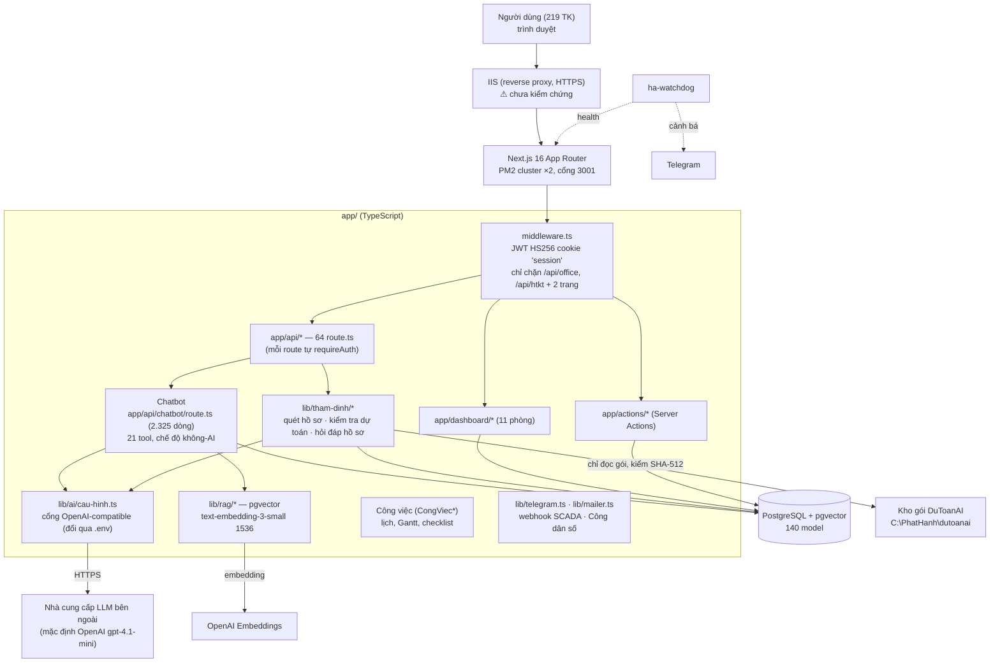

# 01 — Báo cáo khảo sát hệ thống hiện có (QL-HTKT)

> Giai đoạn 1 — chỉ đọc. Ngày khảo sát: 15/10/2026 (bổ sung 21/10/2026).
> Người khảo sát: Claude Code. Phản biện: Codex (xem 05, 06).
> **Không sửa mã, không mở CSDL, không đọc `.env`/khoá bí mật, không truy cập máy chủ production.**

## 0. Phạm vi và giới hạn bằng chứng

| Đối tượng | Đã khảo sát? | Cách | Mức bằng chứng |
|---|---|---|---|
| Mã nguồn QL-HTKT (`app/`, nhánh `ra-soat-csdl-chatbot-phap-ly`, commit `8c11314`) | Có | đọc tệp, `grep` | **M** — mã nguồn (`tệp:dòng`) |
| Tài liệu trong repo (kế hoạch, báo cáo cũ) | Có | đọc | **T** — tài liệu nội bộ, có thể lỗi thời |
| Máy chủ production ("VPS") | **Không** | không có SSH/RDP, không có `.env` trên máy này | **chưa kiểm chứng** |
| Máy đang khảo sát | Có | `systeminfo` | HP Desktop, Windows 11 Home, RAM 16 GB — **đây là máy phát triển, không phải VPS** |
| Phần mềm DuToanAI (`D:\Troly\Dutoan_AI`) | Đọc phần liên thông | đã có bộ nghiên cứu 16 báo cáo riêng (15/10/2026) | tham chiếu, không làm lại |

**Quy ước đường dẫn (áp dụng cho cả bộ 01–14):** đường dẫn mã như `app/api/...`, `app/actions/...`, `lib/...`, `prisma/...` tính từ **thư mục ứng dụng `app/`**
(từ gốc repo là `app/app/api/...`, `app/lib/...`). `CB` = `app/api/chatbot/route.ts`. Đường dẫn Javis tính từ gốc bản clone.

**Hệ quả:** toàn bộ mục 1 (hạ tầng) dưới đây là **mô tả từ tài liệu và cấu hình trong repo**, không phải kết quả đo trên máy chủ.
Phụ lục A liệt kê các lệnh *chỉ đọc* để chủ hệ thống tự chạy trên máy chủ nhằm đóng các mục "chưa kiểm chứng".

## 1. Hạ tầng (theo tài liệu repo — CHƯA KIỂM CHỨNG trên máy chủ)

| Hạng mục | Thông tin từ repo | Nguồn |
|---|---|---|
| Hệ điều hành máy chủ | Windows (đường dẫn `c:\Troly\HTKT\app`, `c:\logs\`, PowerShell, IIS) | `ecosystem.config.js:6,16`; `KE_HOACH_HOAN_THIEN_DU_AN_2026-08.md` mục N1 ("IIS + PM2") |
| RAM | **6 GB** | `KE_HOACH_HOAN_THIEN_DU_AN_2026-08.md:4`; `app/lib/tham-dinh/hoi-dap.ts` (chú thích "Máy chủ 6GB RAM"); `du-lieu-dutoanai.ts:87` |
| Tiến trình | PM2: `ql-htkt` (Next.js, **2 instance cluster**, cổng 3001) + `ha-watchdog`; `max_memory_restart: 500M` là **ngưỡng khởi động lại, không phải trần cấp phát** | `ecosystem.config.js:3-40` |
| Node heap | `NODE_OPTIONS=--max-old-space-size=512` khai ở cấp **ngoài** `apps[]` — **chưa xác nhận được áp vào tiến trình**; dù có áp cũng chỉ giới hạn một phần heap, không phải trần RSS | `ecosystem.config.js:50` |
| Reverse proxy / HTTPS | IIS (theo kế hoạch); watchdog kiểm tra "Website (HTTPS)" | `HA-CODEX-README.md:17`; chưa thấy cấu hình IIS trong repo |
| CSDL | PostgreSQL + pgvector; 140 model Prisma (tài liệu 20/8 ghi 146 bảng) | `app/prisma/schema.prisma:6-7`; `:3021-3029` |
| Quy mô người dùng | 219 tài khoản (20/8/2026) | `KE_HOACH_HOAN_THIEN_DU_AN_2026-08.md:4` |
| Sao lưu | `pg_dump` ra `C:\Backup_QLHTKT\*.dump`; healthcheck đòi bản < 26 giờ và kích thước không giảm > 10 % | `app/scripts/healthcheck.mjs:117-135` |
| Giám sát | `ha-watchdog` 30 s/lần, PM2 reload sau 3 lỗi, cảnh báo Telegram | `HA-CODEX-README.md:14-21`; `app/scripts/ha-watchdog.mjs` |
| Khôi phục thảm hoạ | Kế hoạch 20/8 ghi: khôi phục **đã thử được**; **chưa có** tài liệu dựng lại máy mới, chưa có RPO/RTO, **chưa có bản sao lưu thứ hai ngoài ổ C:** | `KE_HOACH_HOAN_THIEN_DU_AN_2026-08.md` mục N1 |
| Firewall, cổng mở, chứng chỉ SSL, domain | **Không có bằng chứng trong repo** | — |

> ⚠ Kết hợp "6 GB RAM" + "2 instance × 500 MB" + PostgreSQL + IIS cho thấy **dư địa RAM rất hẹp**. Đây là ràng buộc
> **phải đo trước** khi chọn bất kỳ phương án thêm dịch vụ AI chạy thường trực (xem 07, 13) — chưa đo thì chưa xếp hạng được nó so với các ràng buộc khác. Phụ lục A.

## 2. Kiến trúc mã nguồn thực tế



### 2.1 Công nghệ

| Lớp | Công nghệ | Bằng chứng |
|---|---|---|
| Framework | Next.js 16.2, React 19.2 (bản có thay đổi phá vỡ — `AGENTS.md` yêu cầu đọc tài liệu đi kèm) | `app/package.json`; `app/AGENTS.md:1-5` |
| ORM / CSDL | Prisma 7.8 (`@prisma/adapter-pg`), PostgreSQL, pgvector | `app/prisma/schema.prisma:2,7,3029` |
| Xác thực | JWT tự quản (`jose`, HS256, cookie `session`) + `bcryptjs`; `next-auth` 5 beta có trong dependencies | `app/middleware.ts:5-27`; `app/lib/auth.ts` |
| AI | SDK `openai` 6.x (cổng OpenAI-compatible), `@anthropic-ai/sdk` có trong dependencies | `app/lib/ai/cau-hinh.ts:1-60` |
| Đọc tài liệu | `pdfjs-dist`, `mammoth` (DOCX), `xlsx`/`exceljs`, `dxf-parser` | `app/package.json` |
| Xuất tài liệu | `docx`, `pdf-lib`, `exceljs` | `app/package.json`; `app/lib/htkt/van-ban-docx.ts` |
| GIS | `maplibre-gl`, `shapefile`, `@tmcw/togeojson` | `app/package.json` |
| Migration | Prisma migrations (đến 06/2026) + **60 tệp SQL thủ công** `prisma/migrations_manual/` | thư mục |

### 2.2 Các khối AI và tri thức đang có

| Khối | Mô tả từ mã | Bằng chứng |
|---|---|---|
| **Cổng cấu hình AI** | Một đầu mối; đổi nhà cung cấp chat qua `AI_BASE_URL/AI_API_KEY/AI_CHAT_MODEL`; embedding **cố ý tách riêng** để tránh trộn mô hình véc-tơ; phân loại lỗi hết hạn mức | `lib/ai/cau-hinh.ts:4-18, 28-60, 85-100` |
| **Chatbot nghiệp vụ** | 21 tool function-calling: nhân sự, lương, DVHC, lãnh đạo xã, pháp lý nhân sự, pháp lý chuyên ngành, hiệu lực văn bản, nghiệp vụ HTKT, tra tài liệu RAG; **3 tool GHI** (`luu_lanh_dao_xa`, `cap_nhat_luong_can_bo`, `them_can_bo`); thử lại 429/5xx; **chế độ trả lời không cần AI** khi dịch vụ AI lỗi | `app/api/chatbot/route.ts:30-50, 276-583`; `lib/chatbot/tra-loi-khong-ai.ts` |
| **RAG văn bản** | pgvector HNSW, `ef_search=100`, lọc theo `phamVi` theo quyền (`CONG_KHAI`/`NOI_BO_SO`), trả kèm `tinhTrangHieuLuc`, `thayTheBoi` | `lib/rag/search.ts:24-83`; `route.ts:1652` |
| **Hiệu lực văn bản** | Trường `tinhTrangHieuLuc` trên `tai_lieu` (mig 043), đồng bộ từ `prisma/hieu-luc-vbpl.json` | `schema.prisma:3000-3006` |
| **Thẩm định hồ sơ** | Quét thư mục hồ sơ; kiểm tra dự toán Excel (số học, THKP theo Bảng 3.8 TT 36/2026, đối chiếu tỷ lệ bằng gói DuToanAI, dự phòng ≤ 5/10 %); hỏi đáp hồ sơ bằng TF-IDF trong RAM (không lưu nội dung vào CSDL) | `lib/tham-dinh/kiem-tra-du-toan.ts`, `hoi-dap.ts:1-25`, `du-lieu-dutoanai.ts` |
| **Soạn văn bản** | Sinh tờ trình/công văn (streaming), xuất DOCX | `lib/openai.ts:21-55`; `lib/htkt/van-ban-docx.ts` |
| **Nhật ký chatbot** | `ChatbotLog` (câu hỏi/đáp đã **che SĐT, CCCD**, tool đã dùng, phản hồi người dùng); câu trả lời được LIKE tái dùng làm gợi ý (S15) | `schema.prisma:1380-1396`; `route.ts:1964-1969` |
| **Nhật ký truy cập** | `AuditLog`; chatbot ghi `VIEW_SENSITIVE` khi dùng tool nhạy cảm | `schema.prisma:115-130`; `route.ts:1920-1924, 2234-2246` |

### 2.3 Quản lý công việc, tích hợp, kiểm thử

| Khối | Hiện trạng | Bằng chứng |
|---|---|---|
| Công việc | Model `CongViec*` dùng chung 11 phòng, trường động JSONB, hạn (`ngayHetHan`), trạng thái, ưu tiên, thành viên, nhật ký, checklist; UI lịch + Gantt | `schema.prisma:~3040-3140`; `components/cong-viec/*` |
| Nhắc việc / lịch chạy | Không thấy scheduler trong app; tác vụ định kỳ qua **Task Scheduler + script** (`healthcheck-daily.ps1`, `sinh-nhat.mjs`) | `app/scripts/` |
| Telegram / email | `lib/telegram.ts`, `lib/mailer.ts` (nodemailer) | tệp |
| Zalo | Có tài liệu Zalo **OA** (kênh chính thức) | `app/docs/zalo-oa-sinh-nhat.md` |
| Webhook SCADA | Bearer token (xem S1) | `app/api/webhook/infrastructure/route.ts:24-30` |
| Kiểm thử tự động | **1 tệp test** (`lib/qd72/danh-gia.test.ts`); `package.json` **không có script `test`**; thay vào đó là các script smoke/healthcheck (`smoke-chatbot.mjs`, `healthcheck.mjs --chatbot` 9 câu) | tệp |

## 3. Phát hiện chính (có bằng chứng)

| # | Phát hiện | Mức | Bằng chứng | Ghi chú |
|---|---|---|---|---|
> Bảng đã cập nhật sau vòng 3 (06). Cột "Nguồn" ghi ai phát hiện. `CB` = `app/api/chatbot/route.ts`.

| # | Phát hiện | Mức | Bằng chứng | Nguồn | Ghi chú |
|---|---|---|---|---|---|
| S1 | Webhook SCADA có **token dự phòng viết cứng** khi thiếu `WEBHOOK_SECRET`; **GET không xác thực công bố luôn token mặc định** trong phản hồi; POST có nhánh ghi CSDL | **Cao** | `app/api/webhook/infrastructure/route.ts:24, 75, 129-140` | Claude + Codex 2B | Chưa biết production đã đặt biến chưa |
| S2 | Tool **ghi** của chatbot chạy ngay khi LLM gọi; không có xác nhận gắn payload phía máy chủ | Cao | `CB:1007-1075, 1088-1170, 1188-1265` | Claude | Quyền kiểm **trong mã** (đúng); việc *có ghi hay không* do LLM quyết |
| S3 | Ghi qua chatbot: nhật ký chỉ `VIEW_SENSITIVE`, **không trước/sau**; ghi ở nhánh kết thúc bình thường, nuốt lỗi | Trung bình | `CB:2234-2246`; `lib/audit.ts:15` | Claude + Codex | — |
| S4 | Dữ liệu cá nhân và trích đoạn hồ sơ (≤ 14.000 ký tự **phần trích**, chưa gồm danh mục tệp + lịch sử) gửi tới endpoint LLM — **mặc định mã là OpenAI**; production chưa kiểm | Cao (chính sách) | `CB:748-760, 2274-2282`; `hoi-dap.ts:22, 187`; `lib/ai/cau-hinh.ts:28-31` | Claude + Codex | Cần quy chế; NĐ 13/2023 — **chưa đối chiếu văn bản** |
| S5 | Quyền chatbot trộn **email cứng** (admin) với allowlist định danh (S12) và RBAC | Trung bình | `CB:58, 748, 1007` | Claude | — |
| S6 | Middleware chỉ chặn 2 nhánh; route khác tự kiểm. Quét từ khoá: 63/64 có — **không đủ để kết luận an toàn** (VD: S1 GET) | Chưa xác định | `middleware.ts:48-94` | Claude; Codex sửa | Cần ma trận quyền từng method/tool (12 §2) |
| S7 | Hầu như **không có kiểm thử tự động** (1 tệp test, không có script `test`) | Cao | `app/package.json:5`; `lib/qd72/danh-gia.test.ts` | Claude | — |
| S8 | `hieu-luc-vbpl.json`: 123 còn hiệu lực, 3 cần kiểm chứng, 0 hết hiệu lực — **tệp tự ghi là "đánh giá NHÁP do trợ lý đề xuất (4/7/2026)"**; là danh mục trong repo, chưa phải dữ liệu CSDL đang phục vụ | Cao (với Legal Agent) | `prisma/hieu-luc-vbpl.json:2` | Claude + Codex | Không dùng làm căn cứ khi chưa có người có thẩm quyền xác nhận |
| S9 | Thẩm định dự toán mặc định GTGT 10 %; DuToanAI mặc định 8 % | Thấp | `kiem-tra-du-toan.ts:52` | Claude | Đề xuất: **tham số theo ngày áp dụng + nguồn văn bản**, không phải hằng số |
| S10 | Tra bảng tỷ lệ theo bậc | — (**chưa chứng minh lỗi thuật toán; chưa xác nhận đúng nghiệp vụ** của toàn bộ phép đối chiếu — gồm cơ sở quy mô `quyMoTyDong ?? G/1e9`, `kiem-tra-du-toan.ts:788-809`) | `du-lieu-dutoanai.ts:111-117`; DuToanAI `he-so-chi-phi-xay-dung.ts:9,121-140` | Claude | Nhất quán ≠ đúng nghiệp vụ → kiểm thử sát ngưỡng có đáp án pháp chế |
| S11 | `ho_so_can_bo` trả ngày sinh, SĐT, email, hệ số lương cho **mọi TK cấp Sở**, không qua `canViewOfficeSensitive` | **Cao** | `CB:697-712, 747-760, 1819`; `lib/auth.ts:184-192` | Codex 2A | Chủ hệ thống quyết chính sách |
| S12 | Quyền gắn **CCCD cá nhân viết cứng** trong mã | Trung bình | `lib/auth.ts:95-111` | Codex 2A | Không chép số vào báo cáo |
| S13 | Hỏi đáp hồ sơ: nội dung hồ sơ ở `role: 'system'`; lịch sử lấy **từ client** (có rào `<HO_SO>`) | Trung bình | `app/api/htkt/tham-dinh-ho-so/hoi-dap/route.ts:33, 86-105` | Codex 2A | Không có tool ghi ở route này |
| S14 | Che nhật ký chỉ SĐT, CCCD; audit ghi 160 ký tự câu hỏi thô | Trung bình | `CB:1934-1949, 2245` | Codex 2B | — |
| S15 | "Học từ LIKE": câu trả lời được LIKE (không dùng tool) chèn vào **system prompt** người khác, cùng lượt có tool ghi; không lọc chủ sở hữu/phòng | **Cao** khi tool ghi còn bật (vòng 4) | `CB:1861-1903, 2181-2186` | Codex 2B | Có rào lọc dữ kiện động; nguy cơ nhiễm chỉ thị |
| S16 | Cookie phiên `secure` chỉ bật khi `COOKIE_SECURE=true` | Trung bình | `lib/session.ts:50` | Codex 2A | Production chưa kiểm |
| S17 | Ghi trước khi lượt LLM kết thúc → lỗi sau đó → người dùng thử lại → **ghi lặp**; update không kiểm phiên bản | Cao | `CB:1097, 1163, 2215, 2285` | Codex 2B | Cần idempotency + optimistic lock |
| S18 | Ingest RAG lỗi để lại chunk của lần nạp lỗi; tiến trình chết cưỡng bức có thể làm tài liệu kẹt `dang_xu_ly` (tài liệu dở **không** lọt vào tìm kiếm) | Thấp | `lib/rag/ingest.ts`; `search.ts:72` | Codex 2A; Claude hạ mức | — |
| S19 | Nhánh "hết 5 vòng tool" không ghi `VIEW_SENSITIVE` | Trung bình | `CB:2282-2292` | Codex 2B | — |

## 4. Điểm mạnh nên giữ nguyên

1. **Cổng cấu hình AI một đầu mối** với embedding tách riêng — đúng thiết kế, là "Model Gateway" thu nhỏ (`lib/ai/cau-hinh.ts`).
2. **Chế độ không-AI** khi nhà cung cấp lỗi/hết tiền — tính sẵn sàng tốt, hiếm có (`lib/chatbot/tra-loi-khong-ai.ts`).
3. **RAG lọc theo phạm vi quyền ngay trong SQL và trả kèm nhãn hiệu lực** (`lib/rag/search.ts:66-72`) — *chưa* lọc hiệu lực theo thời điểm hồ sơ.
4. **Thẩm định "chỉ phát hiện, chỉ ô nguồn, không kết luận thay cán bộ"** — nguyên tắc đúng cho AI pháp lý (`kiem-tra-du-toan.ts:21-24`).
5. **Liên thông DuToanAI chỉ-đọc có kiểm SHA-512** và tự ghi rõ giới hạn (không giả vờ xác thực chữ ký) (`du-lieu-dutoanai.ts:15-25`).
6. **Che SĐT/CCCD trong nhật ký chatbot** + nhật ký truy cập riêng (phạm vi che còn hẹp — S14).
8. **Lịch sử chatbot lấy từ nhật ký máy chủ**, không tin mảng `messages` của client (`CB:2150-2156`).
7. **Quy trình phản biện Claude ↔ Codex** đã thành nếp (thư mục `scripts/codex-*.md`, các báo cáo `BAO_CAO_CODEX_*`).

## Phụ lục A — Lệnh CHỈ ĐỌC đề nghị chủ hệ thống chạy trên máy chủ production

> Chạy bằng tài khoản quản trị, **chép kết quả, che mọi giá trị bí mật trước khi gửi**. Không lệnh nào thay đổi hệ thống.

```powershell
# Phần cứng, hệ điều hành
Get-ComputerInfo -Property OsName,OsVersion,CsTotalPhysicalMemory,CsNumberOfLogicalProcessors
Get-PSDrive -PSProvider FileSystem | Select Name,Used,Free
Get-Counter '\Memory\Available MBytes'
# Dịch vụ, tiến trình
pm2 ls ; pm2 info ql-htkt
Get-Service | Where-Object {$_.Status -eq 'Running'} | Select Name,DisplayName
Get-Process node,postgres,w3wp -ErrorAction SilentlyContinue | Select Name,Id,WS
# Mạng, firewall, IIS
Get-NetTCPConnection -State Listen | Select LocalAddress,LocalPort,OwningProcess | Sort LocalPort
Get-NetFirewallProfile | Select Name,Enabled,DefaultInboundAction
Get-NetFirewallRule -Enabled True -Direction Inbound | Select DisplayName,Action | Select -First 50
Import-Module WebAdministration; Get-Website | Select Name,State,Bindings
Get-ChildItem Cert:\LocalMachine\My | Select Subject,NotAfter
# Sao lưu
Get-ChildItem C:\Backup_QLHTKT -Filter *.dump | Sort LastWriteTime -Desc | Select -First 5 Name,Length,LastWriteTime
Get-ScheduledTask | Where-Object {$_.TaskPath -notlike '\Microsoft*'} | Select TaskName,State
# Chỉ kiểm tra biến có được ĐẶT hay không (không in giá trị)
Select-String -Path C:\Troly\HTKT\app\.env -Pattern '^(WEBHOOK_SECRET|SESSION_SECRET|AI_BASE_URL)=' | ForEach-Object { ($_.Line -split '=')[0] + '=<đã đặt>' }
```
