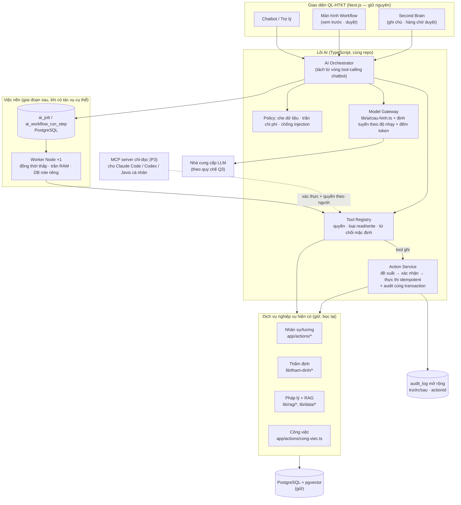

# 08 — Kiến trúc đề xuất: "B từng bước"

> Nguyên tắc chốt sau vòng 3: **chốt quyền và tính nhất quán TRƯỚC khi thêm tiến trình**; schema riêng hay giao thức MCP
> **không** tự thân là biện pháp bảo mật (Codex 2B). LLM không tính tiền, không viết số tự do, không tự phát hành văn bản.

## 1. Sơ đồ đích

## 2. Quyết định kiến trúc (ADR)

`CB` = `app/app/api/chatbot/route.ts`; mã S-xx xem 01 §3.

| ADR | Quyết định | Phương án bị loại | Lý do / bằng chứng |
|---|---|---|---|
| 1 | Một stack TS/Next.js + PostgreSQL | stack Python Javis | 07 §2 |
| 2 | Orchestrator **tách từ** vòng tool-calling hiện có, giữ chế độ không-AI | viết mới | `CB:2195-2290`; `lib/chatbot/tra-loi-khong-ai.ts` |
| 3 | Tool registry **từ chối mặc định**: tool chưa khai báo `read/write` + quyền → không được gọi | heuristic tên tool (Javis) | `mcp_catalog.py:498-510` |
| 4 | Mọi hành động **nghiệp vụ** ghi qua **Action Service**: (a) đề xuất tạo `ai_action` với `payload` **bất biến** + hash, `targetVersion`, `expiresAt` (15 phút); (b) người có quyền xác nhận **đúng hash đó** trên màn hình xem trước (không phải câu "đồng ý" trong hội thoại); (c) khi thực thi: **kiểm quyền lại**, kiểm `targetVersion` (optimistic lock), rồi mutation + audit trước/sau + đánh dấu `ai_action` đã thực hiện **trong cùng một transaction**; audit lỗi → rollback; (d) khoá idempotency = `actionId` sinh **một lần ở bước đề xuất** và được giữ qua retry/resume (retry không tạo actionId mới) | LLM ghi trực tiếp; xác nhận bằng hội thoại | S2, S3, S17; Codex vòng 4 |
| 5 | Kiểm quyền **tại từng lời gọi tool** bằng danh tính người yêu cầu; bỏ allowlist CCCD/email cứng → `Permission`. Tách logic nghiệp vụ khỏi Server Action thành **dịch vụ nhận `actor` + transaction tường minh**, để cả web action (actor từ phiên) và worker (actor = người yêu cầu job, quyền kiểm lại lúc chạy) gọi chung — **không** bọc Server Action cũ (vốn gọi `requireAuth()` theo phiên web) | quyền theo route | S5, S11, S12; Codex vòng 4 |
| 6 | Model Gateway là **cổng ra duy nhất**: mọi đường ra (chat, embedding, retry, lịch sử, workflow) đều qua policy che/chặn theo độ nhạy + đếm token + **dự giữ ngân sách** (13 §2). Dữ liệu nhân sự/hồ sơ chỉ đi tới nhà cung cấp được Q3 cho phép, hoặc không gửi | gửi mọi thứ | S4; 13 |
| 7 | Nội dung tài liệu/hồ sơ **luôn ở role `user`/tool**, bọc thẻ dữ liệu; lịch sử lấy từ máy chủ. Biện pháp này **giảm** chứ không **bảo đảm** chống injection → lớp chặn cứng là ADR-4: không đề xuất ghi nào được thực thi nếu thiếu xác nhận của người | để ở `system` | S13; Codex vòng 4 |
| 8 | Second Brain lưu **PostgreSQL** (3 lớp: gốc / đề xuất / đã duyệt), có chủ sở hữu, phạm vi, nguồn, phiên bản, hạn; markdown/git chỉ là **bản xuất**. **Truyền quyền:** tri thức dẫn xuất kế thừa phạm vi **chặt nhất** trong các nguồn; bản xuất chỉ gồm mục người xuất có quyền đọc | thư mục markdown làm nguồn chính | Codex 2B #4, vòng 4 |
| 9 | "Học từ LIKE" chuyển thành nguồn **đề xuất** vào hàng chờ duyệt, không chèn thẳng system prompt | giữ nguyên | S15 |
| 10 | Pháp lý: bảng **quan hệ văn bản** có kiểu (sửa đổi/thay thế/hướng dẫn/chuyển tiếp) + ngày hiệu lực; truy vấn "tại ngày X"; thêm FTS `tsvector` (hybrid). Quy tắc khi thiếu dữ liệu: **thiếu ngày hồ sơ, thay thế một phần, chuyển tiếp, nguồn chưa xác nhận → trả "không đủ căn cứ để khẳng định hiệu lực", không suy đoán** | KG tổng quát | S8; 03; Codex vòng 4 |
| 11 | Việc nền: bảng job + checkpoint trong PostgreSQL; **chỉ thêm worker khi có tác vụ cụ thể**; worker dùng **DB role riêng** quyền tối thiểu. Nhận job bằng **lease có hạn** (`SELECT … FOR UPDATE SKIP LOCKED` + `leaseUntil`); job hết lease được nhận lại; node có side effect gắn `actionId` (ADR-4) nên chạy lại **không** ghi lặp kể cả khi chết giữa "commit mutation" và "ghi checkpoint"; thông báo ra ngoài (Telegram/email) có khoá chống gửi lặp riêng | scheduler 30 s trong web process | S20; Javis `workflow_runtime.py` (mẫu); Codex vòng 4 |
| 12 | MCP chỉ là **adapter cho client ngoài** (giai đoạn sau), xác thực theo người dùng; nội bộ gọi dịch vụ trực tiếp | MCP làm lõi | Codex 2B |
| 13 | Không: Zalo cá nhân, engine có shell, plugin tuỳ ý, tự cập nhật production, voice, LLM cục bộ (giai đoạn đầu) | — | 02 §3 |

## 3. Mô hình dữ liệu bổ sung (phác thảo — chưa phải migration)

| Bảng | Trường chính |
|---|---|
| `ai_action` | `id` (actionId), `tool`, `requestedBy`, `payload` JSONB, `targetType/Id`, `targetVersion`, `trangThai` (DE_XUAT/DA_XAC_NHAN/DA_THUC_HIEN/HET_HAN/TU_CHOI), `expiresAt`, `confirmedBy` |
| `audit_log` (mở rộng) | + `actionId`, `before` JSONB, `after` JSONB — ghi **trong cùng transaction** với thay đổi |
| `ai_job`, `ai_workflow_run_step` | `workflow`, `node`, `status`, `inputHash`, `output`, `model`, `tokensIn/Out`, `startedAt/endedAt`, `approvedBy` |
| `tri_thuc` | `lop` (GOC/DE_XUAT/DA_DUYET), `chuSoHuu`, `phamVi`, `nguon[]`, `phienBan`, `hieuLucTu/Den`, `duyetBoi` |
| `van_ban_quan_he` | `vanBanId`, `quanHe` (SUA_DOI/THAY_THE/HUONG_DAN/CHUYEN_TIEP), `vanBanLienQuanId`, `phamVi` (toàn bộ/điều…), `hieuLucTu` |
| `ai_usage` | `ngay`, `nhaCungCap`, `model`, `loaiViec`, `tokensIn/Out`, `chiPhiUocTinh` |

## 4. Ngân sách tài nguyên (phải đo ở B0 trước khi chốt)

| Thành phần | Đề xuất | Cần đo |
|---|---|---|
| Web (2 instance) | giữ | RSS thực, heap, có áp `NODE_OPTIONS` không (S20) |
| Worker | 1 tiến trình, đồng thời 1–2 job, chạy ngoài giờ cao điểm cho job nặng. `--max-old-space-size` chỉ giới hạn **một phần heap**, không phải trần RSS (buffer, parser PDF/Excel nằm ngoài) | RSS thực khi chạy WF1 với hồ sơ lớn |
| PostgreSQL | giữ; giới hạn `work_mem` cho truy vấn vector | buffer, paging |
| Ngưỡng an toàn | **Giả thuyết vận hành** (chưa phải bằng chứng sức chứa): RAM trống ≥ 1 GB lúc cao điểm. Phải kiểm bằng tải đại diện: số phiên đồng thời thực, paging, độ trễ p95, số lần PM2 restart; không đạt → tách worker sang máy khác (Q7) | Phụ lục A 01; 12 §1 Performance |

## 5. Tại sao không phải "B+"

So với đề xuất vòng 1, bản này (theo Codex 2B, Claude chấp thuận): bỏ cam kết thêm worker ngay; đưa xác nhận/idempotency/audit nguyên tử lên đầu;
thêm DB role riêng; coi MCP là adapter, không phải ranh giới bảo mật.
