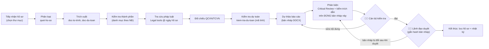
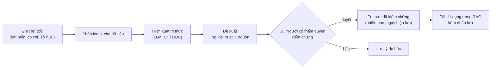

# 09 — Thiết kế Agent, Skill và Workflow

> Nguyên tắc: **"Agent" là vai trò + bộ công cụ + quyền**, không mặc định là một tiến trình/model riêng.
> Giai đoạn đầu chạy **một Orchestrator** chọn vai trò theo loại việc; chỉ tách thành agent độc lập khi thí nghiệm (§4) chứng minh lợi ích.

## 1. Danh mục vai trò (10 module mục VI)

| Vai trò | Công cụ (tool/MCP) — ưu tiên tái dùng mã có sẵn | Quyền | Ghi chú |
|---|---|---|---|
| Orchestrator | phân loại yêu cầu, chọn workflow, gọi vai trò | không truy cập dữ liệu trực tiếp | Tách từ vòng tool-calling của `app/api/chatbot/route.ts` |
| Legal Research | `tra_cuu_phap_ly_chuyen_nganh`, `tra_cuu_hieu_luc_van_ban`, `tra_cuu_tai_lieu` (RAG) + **mới**: `quan_he_van_ban`, `tim_dieu_khoan` (FTS) | đọc | Mọi trích dẫn phải trả về `taiLieuId + điều/khoản/điểm + tình trạng hiệu lực tại ngày X` |
| Construction Appraisal | `lib/tham-dinh/quet-ho-so`, `kiem-tra-du-toan`, `doc-to-trinh`, `doc-du-toan`, `hoi-dap`; MCP DuToanAI chỉ-đọc (tương lai) | đọc hồ sơ trong thư mục đã chọn | **Số học do mã tính, LLM không tính tiền** |
| Document | đọc PDF/DOCX/XLSX; `van-ban-docx.ts`; **mới**: so sánh điều khoản 2 phiên bản | đọc; ghi **bản nháp** | Không phát hành |
| Critical Review | lượt LLM riêng với prompt đối kháng + **kiểm tra cứng**: mọi số hiệu văn bản trong bản nháp phải tồn tại trong kho và còn hiệu lực tại ngày áp dụng | đọc | Bước bắt buộc trước "Trình duyệt" |
| Task Management | đọc/ghi `CongViec*` **qua server actions có sẵn** (`app/actions/cong-viec.ts`) | ghi qua đề xuất | Không ghi thẳng Prisma |
| Automation | hàng đợi việc nền (PostgreSQL) + worker | theo workflow đã duyệt | Trần RAM/CPU, giờ chạy ngoài giờ cao điểm |
| Integration Hub | Telegram (đã có), email (đã có), Zalo **OA** (nếu cấp), MCP | gửi **chỉ tới danh sách nội bộ đã duyệt** | Không tự gửi ra ngoài |
| Knowledge Manager (Second Brain) | ghi chú gốc, đề xuất tri thức, hàng chờ duyệt | ghi lớp "đề xuất"; người duyệt nâng lớp | Xem §3 workflow 3 |
| Security & Audit | nhật ký trước/sau, cổng xác nhận, che dữ liệu, định tuyến model theo độ nhạy | — | Lớp xuyên suốt, không phải agent |

## 2. Skill

Skill = tệp mô tả quy trình chuyên môn (markdown + front-matter), **phiên bản hoá trong repo**, nạp có chọn lọc vào prompt (ý tưởng `skill_router` của Javis).
Skill **không** chứa mã thực thi; mọi hành động đi qua tool có kiểm quyền.

| Skill khởi đầu | Nguồn nội dung đã có |
|---|---|
| `tham-dinh-bcnckt` | `Bo_Prompt_Tham_Dinh_BCNCKT_2026.md` |
| `kiem-tra-du-toan` | `lib/tham-dinh/kiem-tra-du-toan.ts` (nguyên tắc), prompt mục 15–18 |
| `gop-y-van-ban` | mới — theo Workflow 2 |
| `xu-ly-vphc` | `Quy_trinh_xu_ly_VPHC_ND339_ND311_2026.docx` |
| `cchn` | `Kiem_chung_CCHN_Giam_sat_thi_cong_ND212_2026.md`, `lib/cchn/*` |

## 3. Workflow

Ký hiệu điểm kiểm tra con người: 🧑‍⚖️. Phân biệt hai loại ghi (đính chính vòng 4):
- **Ghi vận hành** (checkpoint, `ai_usage`, audit, tạo *đề xuất* tri thức/hành động): tự động, không cần duyệt.
- **Hành động nghiệp vụ** (đổi dữ liệu nhân sự, công việc, hồ sơ; gửi thông báo ra ngoài; phát hành văn bản): node dừng ở `CHO_DUYET` (mẫu `WAITING_USER` của Javis `workflow_runtime.py:13-15`) và chỉ thực thi qua Action Service (08 ADR-4).

Checkpoint lưu ở `ai_workflow_run_step`. **Checkpoint một mình không chống ghi lặp**: nếu tiến trình chết sau khi mutation đã commit nhưng trước khi
ghi checkpoint, resume sẽ chạy lại node đó → chống lặp dựa vào `actionId` ổn định của node (08 ADR-4d, ADR-11), không dựa vào trạng thái node.

### Workflow 1 — Thẩm tra, thẩm định

| Thuộc tính | Nội dung |
|---|---|
| Input | thư mục hồ sơ (whitelist `lib/tham-dinh/duong-dan.ts`), loại hồ sơ, ngày tiếp nhận |
| Output | bảng phát hiện có nguồn ô/trang, danh mục căn cứ có trạng thái hiệu lực, **bản nháp** báo cáo |
| Kích hoạt | cán bộ bấm "Phân tích hồ sơ" |
| Quyền | `requireHtktAccess` + phạm vi phòng |
| Lỗi/retry | node LLM: retry 3 lần (800/2000/4500 ms, đã có ở `goiOpenAI`); node đọc tệp: không retry, ghi tệp lỗi vào kết quả |
| Timeout | node LLM 60 s; toàn workflow 15 phút; quá hạn → `TAM_DUNG`, giữ checkpoint |
| Nhật ký | mỗi node: input hash, output, model, token, thời gian, người duyệt |
| Kiểm thử | 12 §4 — bộ hồ sơ mẫu ẩn danh có đáp án |
| Kết thúc | lãnh đạo duyệt hoặc cán bộ huỷ |

### Workflow 2 — Góp ý văn bản

Tiếp nhận dự thảo → xác định phạm vi chức năng phòng (`lib/phong/*`) → tra căn cứ → tách điều khoản → phân tích từng điều →
phản biện → **bảng "câu A → câu B" kèm lý do + căn cứ** → dự thảo công văn → 🧑‍⚖️ chuyên viên → 🧑‍⚖️ lãnh đạo.
Output: DOCX bảng góp ý + công văn nháp. Không gửi đi.

### Workflow 3 — Second Brain

Quy tắc kế thừa từ Javis `learn.py:4-20`: tiến trình trích xuất **không có quyền ghi**; chỉ mã tin cậy ghi vào lớp đề xuất;
quét bí mật + quét injection trước khi lưu; **câu trả lời của AI không có nguồn không bao giờ thành tri thức**.
Dữ liệu cá nhân của cán bộ (ghi chú riêng) và dữ liệu công vụ ở **hai phạm vi tách biệt**.

### Workflow 4 — Điều hành công việc

Thu thập (từ giao việc, văn bản đến, ghi chú) → xác định hạn → ưu tiên → theo dõi → nhắc (Telegram/email nội bộ) → báo cáo tuần.
Tạo/sửa việc = **đề xuất**, người giao việc xác nhận; dùng `app/actions/cong-viec.ts` để giữ kiểm quyền và nhật ký có sẵn.
Giao diện "nhật ký ngày" kiểu Bullet Journal: việc hôm nay · việc tồn được "chuyển" (migrate) · ghi chú nhanh.

### Workflow 5 — Nghiên cứu phát triển sản phẩm

Researcher → Product → Technical → Financial → Critic → tổng hợp. Đây là workflow **nội bộ phát triển**, chạy bằng
Claude Code/Codex trên máy phát triển (như chính hồ sơ này), **không** cần đưa vào production.

## 4. Khi nào tách agent riêng — thí nghiệm K1/K2/K3

> Đặt tên K1–K3 để không nhầm với phương án kiến trúc A/B/C ở 07.

| Cấu hình | Mô tả |
|---|---|
| K1 | 1 lượt LLM + tool |
| K2 | Orchestrator + vai trò (cùng model, prompt khác, ngữ cảnh chung) |
| K3 | Agent riêng — **cùng model với K2**, chỉ khác ở **ngữ cảnh tách riêng** (để cô lập lợi ích của việc tách agent). Thử model khác là một thí nghiệm riêng sau đó |

Bộ đo: **tập phát triển** của bộ 100 câu pháp lý (12 §3) + 10–20 hồ sơ ẩn danh (12 §4); mỗi cấu hình chạy ≥ 3 lần để thấy biến động.
Chỉ số: độ đúng, trích dẫn đúng, token, độ trễ. Tách agent chỉ khi K3 hơn K2 ≥ 10 điểm % về độ đúng (vượt biến động giữa các lần chạy) mà chi phí ≤ 2×.
