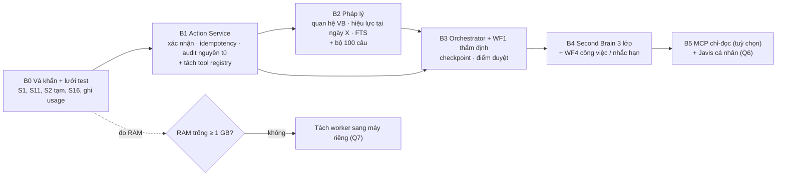

# 11 — Lộ trình triển khai (chờ phê duyệt từng đợt)

> **Chưa triển khai gì.** Mỗi đợt cần chủ hệ thống duyệt riêng; thử nghiệm trên **staging** trước, production sau.
> Thứ tự theo nguyên tắc Codex 2B mà Claude chấp thuận: **an toàn → quyền & nhất quán → đo đạc → tính năng**.

## 1. Các đợt

| Đợt | Nội dung | Tiêu chí nghiệm thu | Phụ thuộc | Ưu tiên |
|---|---|---|---|---|
| **B0** | (1) S1: bỏ fallback token + GET không trả cấu hình + kiểm/xoay `WEBHOOK_SECRET` production; (2) S11: gắn quyền nhạy cảm cho `ho_so_can_bo`; (3) S2/S15/S17 tạm thời: **tắt 3 tool ghi** của chatbot (xác nhận bằng hội thoại không đủ — 10 §2); (4) S16, S19, ghi `usage` token; (5) dựng Vitest + **ma trận quyền** cho 21 tool + route nhạy cảm; (6) đo RAM production (Phụ lục A 01); (7) diễn tập khôi phục DB + tệp trên máy cô lập | test ma trận quyền xanh; báo cáo RAM; biên bản khôi phục | Q1, Q2 | **P0** |
| **B1** | Action Service (ADR-4), tool registry từ chối mặc định (ADR-3), quyền tại từng lời gọi (ADR-5), bỏ allowlist CCCD/email (S5, S12), mở rộng che log (S14) | test idempotency/đồng thời/audit nguyên tử (12 §2) xanh | B0 | P0 |
| **B2** | `van_ban_quan_he`, truy vấn hiệu lực theo ngày, FTS hybrid; **pháp chế duyệt** dữ liệu hiệu lực (thay bản "nháp" S8); bộ đánh giá 100 câu | 0 căn cứ không tồn tại; ≥ 95 % trích dẫn đúng trên tập giữ kín | B1, Q8 | P1 |
| **B3** | Orchestrator dùng chung (chatbot + thẩm định); WF1 có checkpoint + 🧑‍⚖️; bước Critical Review + kiểm trích dẫn tự động; ADR-7 (dữ liệu ở role user) | ngưỡng ở 12 §4 (recall lỗi đã biết, precision, thời gian) trên 10–20 hồ sơ ẩn danh | B1, B2 | P1 |
| **B4** | Bảng `tri_thuc` 3 lớp + hàng chờ duyệt; chuyển "học từ LIKE" thành đề xuất (ADR-9); WF4 nhắc hạn công việc + nhật ký ngày | không tri thức nào vào lớp "đã duyệt" khi chưa có người duyệt | B3 | P2 |
| **B5** | MCP server chỉ-đọc có xác thực theo người; tuỳ chọn Javis cá nhân trên máy riêng | kiểm thử quyền qua MCP | B4, Q6 | P3 |

## 2. Nguồn lực (ước lượng thô — hiệu chỉnh sau B0)

| Đợt | Người-tuần phát triển | Công chuyên gia | Độ tin cậy |
|---|---|---|---|
| B0 | 2–3 | — | Trung bình |
| B1 | 2–3 | — | Thấp |
| B2 | 2–3 | pháp chế 2–3 (soạn + ký 100 câu, duyệt hiệu lực) | Thấp |
| B3 | 3–5 | cán bộ thẩm định 1–2 (đáp án hồ sơ mẫu) | Thấp |
| B4 | 2–3 | người duyệt tri thức (thường xuyên) | Thấp |
| B5 | 1–2 | — | Trung bình |

Phản biện Codex cho từng đợt có thay đổi mã liên quan tiền/quyền/dữ liệu cá nhân (theo nếp đã có trong repo).

## 3. Rủi ro lộ trình

| Rủi ro | Giảm thiểu |
|---|---|
| Không có staging | Q2 — không làm B1 trở đi trên production trực tiếp |
| Không có người duyệt pháp lý | B2 chỉ làm phần kỹ thuật; Legal Agent giữ nhãn "chưa kiểm chứng" |
| RAM không đủ | tách worker (Q7) trước B3 |
| Hết hạn mức LLM | đã có chế độ không-AI; thêm trần chi phí (13) |
| Quy chế dữ liệu chưa có (Q3) | **Không mở rộng** bất kỳ đường gửi dữ liệu cá nhân/hồ sơ mới nào ra LLM ngoài; các đường đang chạy (chatbot nhân sự, hỏi đáp hồ sơ) giữ nguyên **cho tới khi chủ hệ thống quyết Q3** — nếu Q3 cấm, tắt các tool nhân sự nhạy cảm và hỏi đáp hồ sơ trên nhà cung cấp ngoài. Thực thi bằng danh sách tool được phép trong Model Gateway (ADR-6) |
