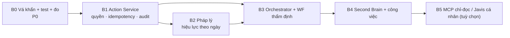

# 14 — Báo cáo tổng hợp: HTKT Brain AI

> **Giai đoạn khảo sát, phản biện và thiết kế — CHƯA TRIỂN KHAI.** Ngày lập: 15–21/10/2026.
> Không sửa mã nguồn, không mở CSDL, không đọc `.env`/khoá bí mật, không truy cập máy chủ production, không cài Javis OS.
> Phản biện chéo Claude Code ↔ OpenAI Codex chạy **thật** qua `codex-cli 0.162.0-alpha.17.2` (`codex exec --sandbox read-only`), 4 lượt Codex.

## 1. Kết luận một câu

**Chọn phương án B ("B từng bước"):** giữ QL-HTKT làm hệ thống nghiệp vụ, xây lớp AI Orchestrator trong **cùng stack TypeScript/PostgreSQL**;
dùng Javis OS làm **nguồn mẫu thiết kế**, **không** chạy Javis trên máy chủ nghiệp vụ. Trước mọi tính năng mới phải làm **B0: vá khẩn + lưới kiểm thử + đo RAM**.

Kết luận của Codex vòng 4: **"ĐẠT CÓ ĐIỀU KIỆN để trình chủ hệ thống quyết định định hướng"** — chưa đủ để phê duyệt triển khai trọn gói,
chưa đủ bằng chứng để cam kết tổng chi phí hay sức chứa máy 6 GB. 4 điều kiện sửa hồ sơ của Codex đã được Claude xử lý (06 §5).

## 2. Hiện trạng (01, 03)

QL-HTKT là ứng dụng Next.js 16 + Prisma 7 + PostgreSQL/pgvector (140 model, 64 route API), chạy PM2 ×2 trên máy chủ Windows
(theo tài liệu: 6 GB RAM, 219 tài khoản — **chưa kiểm chứng trên máy chủ**). AI đã có ở chatbot (21 tool, chế độ không-AI khi nhà cung cấp lỗi),
RAG văn bản có lọc phạm vi quyền, thẩm định hồ sơ/dự toán (mã tính, liên thông DuToanAI chỉ-đọc), soạn văn bản, quản lý công việc.

**Nên giữ nguyên và mở rộng tại chỗ** — không xây song song: cổng cấu hình AI, chế độ không-AI, RAG, lõi thẩm định, công việc, xuất văn bản.

## 3. Phát hiện quan trọng nhất (đã được cả Claude và Codex kiểm lại trên mã)

| Mức | Phát hiện | Mã |
|---|---|---|
| **Cao** | Webhook SCADA có token mặc định trong mã, **GET công khai luôn token đó** | S1 |
| **Cao** | Mọi tài khoản cấp Sở xem được ngày sinh, SĐT, hệ số lương của đồng nghiệp qua chatbot | S11 |
| **Cao** | Chatbot **ghi** dữ liệu lương/nhân sự ngay khi LLM gọi tool; không xác nhận gắn payload, có thể ghi lặp, nhật ký không có trước/sau | S2, S3, S17 |
| **Cao** | Câu trả lời được "LIKE" chèn vào system prompt người khác, cùng lượt có tool ghi | S15 |
| **Cao** | Dữ liệu cá nhân và trích đoạn hồ sơ gửi tới nhà cung cấp LLM (mặc định OpenAI) — **chưa có quy chế** | S4 |
| **Cao** | Dữ liệu hiệu lực văn bản trong repo tự ghi là **"đánh giá NHÁP do trợ lý đề xuất"** | S8 |
| **Cao** | Gần như không có kiểm thử tự động (1 tệp test) | S7 |
| TB | Quyền gắn CCCD/email cá nhân viết cứng; cookie `secure` phụ thuộc biến môi trường; che nhật ký hẹp | S5, S12, S14, S16 |

**Không phát hiện lỗi thuật toán** ở tra bảng tỷ lệ (S10) — nhưng **chưa xác nhận đúng nghiệp vụ**; cần đáp án chuyên gia.

## 4. Bảng bất đồng / vấn đề còn phải phân xử bằng thử nghiệm

> Sau vòng 4, Claude chấp thuận toàn bộ ý kiến Codex sau khi tự kiểm lại mã; **không còn bất đồng về lập luận**. Các mục dưới đây
> là chỗ **cả hai bên thừa nhận chưa có bằng chứng**, không thể đóng bằng tranh luận. Đồng thuận giữa hai AI **không** thay cho kiểm thử.

| Nội dung | Quan điểm Codex | Quan điểm Claude | Bằng chứng hiện có | Rủi ro | Thử nghiệm phân xử |
|---|---|---|---|---|---|
| Điểm C (3,10 Claude vs 3,90 Codex) | Phải chốt danh mục module C rồi chấm lại cùng rubric | Chênh lệch có thể do định nghĩa C khác nhau; **chỉ dùng thứ hạng** | 07 §1–§3 | Trung bình | Hai lát cắt cùng chức năng (TS vs module Python Javis chọn lọc): so công, quyền, RSS, vận hành |
| Sức chứa máy 6 GB | Chưa đủ căn cứ cho dùng chung | Như Codex; ngưỡng "≥ 1 GB trống" chỉ là giả thuyết | tài liệu repo, chưa đo | Cao | Phụ lục A (01) + tải đại diện trên staging cấu hình giống production |
| Tính đúng nghiệp vụ tra bảng tỷ lệ (S10) | Chưa đủ chứng cứ | Không thấy lỗi thuật toán | mã HTKT + DuToanAI | Trung bình | Đáp án chuyên gia từng Bảng 3.3–3.7, sát ngưỡng (12 §2.2) |
| Khả năng khai thác S15 thực tế | Có đường tác động, chưa chứng minh khai thác | Đồng ý — xử lý tạm bằng tắt tool ghi | `CB:2186, 2199-2203` | Cao | 12 §2.2 ca "LIKE xuyên phòng" |
| Hiệu quả chống injection của ADR-7 | Giảm, không bảo đảm | Đồng ý — lớp chặn cứng là ADR-4 | thiết kế | Trung bình | 12 §2 S13 + ca đối kháng |

## 5. Nội dung cần chủ hệ thống quyết định

| # | Câu hỏi | Ảnh hưởng | Người/đơn vị đề xuất quyết định |
|---|---|---|---|
| **Q1** | Duyệt **B0** (vá S1, S11; **tắt 3 tool ghi chatbot**; S16, S19; ghi token; bộ test ma trận quyền; đo RAM; diễn tập khôi phục)? | an toàn ngay | Chủ hệ thống |
| **Q2** | Có/dựng **môi trường staging** riêng (dữ liệu giả/ẩn danh) không? | B1 trở đi chỉ làm trên staging | Chủ hệ thống + quản trị máy chủ |
| **Q3** | **Quy chế dữ liệu ra LLM ngoài**: loại dữ liệu nào được gửi (nhân sự? hồ sơ thẩm định?), nhà cung cấp nào, có ký thoả thuận xử lý dữ liệu không | ADR-6; có thể phải tắt tool nhạy cảm | Lãnh đạo Sở + bộ phận pháp chế/CNTT (đối chiếu NĐ 13/2023 — **chưa đối chiếu trong hồ sơ này**) |
| **Q4** | Trường nào là "nhạy cảm" (ngày sinh, SĐT, lương…) và ai được xem qua chatbot | S11 | Chánh Văn phòng Sở |
| **Q5** | Có cho phép engine chạy bằng **gói thuê bao cá nhân** (Claude Code/ChatGPT) cho công vụ không | C-11 | Chủ hệ thống |
| **Q6** | Dùng Javis OS **cá nhân, tách biệt** (máy riêng, MCP chỉ-đọc) hay không dùng | B5 | Chủ hệ thống |
| **Q7** | Ngân sách nâng RAM / máy riêng cho worker AI; nhà cung cấp; mốc thời gian | B3 | Chủ hệ thống + kế toán |
| **Q8** | **Người có thẩm quyền ký đáp án** bộ 100 câu pháp lý và duyệt dữ liệu hiệu lực văn bản (thay bản "nháp") | B2, S8 | Phòng/Bộ phận pháp chế |
| **Q9** | Người duyệt tri thức Second Brain (lớp "đã duyệt") theo từng lĩnh vực | B4 | Trưởng các phòng |
| **Q10** | Ngưỡng nghiệm thu AI (12 §3, §4) — chấp nhận mức đề xuất hay điều chỉnh | nghiệm thu | Chủ hệ thống |
| **Q11** | Có cung cấp 10–20 hồ sơ thẩm định đã có kết quả (ẩn danh) làm bộ đáp án không | B3 | Phòng HTKT |
| **Q12** | Cho phép chạy **Phụ lục A (01)** — lệnh chỉ đọc — trên máy chủ production và gửi kết quả (đã che bí mật) | đóng các mục "chưa kiểm chứng" hạ tầng | Quản trị máy chủ |

## 6. Lộ trình (11) và chi phí (13)

Nguồn lực ước lượng thô: **12–19 người-tuần phát triển + 3–5 người-tuần chuyên gia** (11 §2) — hiệu chỉnh sau B0; **không** dùng làm dự toán kinh phí.
Chi phí AI vận hành **chưa đo được** vì chatbot chưa ghi số token (13 §1) — việc đầu tiên của B0.

## 7. Giới hạn của hồ sơ này

- **Không khảo sát được máy chủ production**: mọi số hạ tầng là từ tài liệu repo (01 §0, Phụ lục A).
- Javis OS được đọc mã tĩnh (bản sao chỉ đọc tại `D:\Troly\QLHTKT\_research\javis-os`, commit `24c0c6d`) — **chưa chạy, chưa chạy test**.
- Thông tin OpenClaw, Hermes Agent là **nguồn web bên thứ ba** (02 §5), không dùng làm căn cứ quyết định.
- Văn bản pháp luật được nhắc (NĐ 13/2023, TT 36/2026…) **chưa đối chiếu bản gốc** trong hồ sơ này.
- Tài nguyên tạo ra ngoài repo: thư mục nghiên cứu `D:\Troly\QLHTKT\_research\javis-os` (có thể xoá sau khi duyệt hồ sơ).

## 8. Danh mục báo cáo

01 khảo sát hệ thống · 02 Javis OS & mô hình tham khảo · 03 ma trận chức năng · 04 đánh giá Claude (vòng 1, giữ nguyên văn) ·
05 phản biện Codex (nguyên văn 2A, 2A-bis, 2B, vòng 4) · 06 giải trình (vòng 3 + xử lý vòng 4) · 07 so sánh phương án ·
08 kiến trúc đề xuất (13 ADR) · 09 Agent/Skill/Workflow · 10 bảo mật · 11 lộ trình · 12 kiểm thử · 13 chi phí · 14 tổng hợp.

## 9. Quyết định của chủ hệ thống (21/10/2026)

| # | Quyết định | Hệ quả ghi nhận |
|---|---|---|
| Q1 | **Duyệt toàn bộ B0** | Làm trên nhánh riêng; mỗi bản vá qua Codex phản biện; chưa đưa lên production khi chưa duyệt bản vá |
| Q2 | Staging trên **máy/VPS riêng** | Diễn tập khôi phục và B1+ chờ có VPS (Q7) |
| Q3 | **Chặn dữ liệu nhân sự định danh** ra LLM ngoài; hồ sơ thẩm định vẫn được gửi | Thực thi ở B1 (ADR-6); trong lúc chờ: không mở rộng luồng nhân sự |
| Q4 | Nhạy cảm qua chatbot: **CCCD + ngày sinh + lương** (hệ số, phụ cấp, vượt khung, ngày nâng lương); SĐT/email công vụ vẫn tra được | B0 mục 2 |
| Q5 | **Cho phép engine thuê bao cá nhân cả production** | ⚠ Rủi ro điều khoản dịch vụ nhà cung cấp và tính liên tục (tài khoản cá nhân có thể bị khoá/hết hạn). Quy chế Q3 **áp dụng cả cho engine này** — dữ liệu nhân sự định danh không đi qua |
| Q6 | **Dùng thử Javis trên máy riêng** | Không kết nối dữ liệu QL-HTKT cho tới khi có MCP chỉ-đọc (B5); áp biện pháp ở 10 §3 (tắt plugin người dùng, ghim phiên bản, không đặt bí mật QL-HTKT trên máy đó) |
| Q7 | **Thuê VPS ngay** | Chờ chủ hệ thống cung cấp nhà cung cấp + ngân sách |
| Q8 | **Chưa xác định** người ký đáp án pháp lý | B2 chỉ làm phần kỹ thuật; Legal Agent giữ nhãn "chưa kiểm chứng"; dữ liệu hiệu lực vẫn là "nháp" |
| Q9 | Trưởng phòng theo lĩnh vực duyệt tri thức | B4 |
| Q10 | **Ngưỡng chặt hơn** — tạm áp ≥ 98 % cho trích dẫn, phiên bản, hiệu lực, thẩm quyền (chủ hệ thống có thể chỉnh) | 12 §3 |
| Q11 | Phòng HTKT chuẩn bị 10–20 hồ sơ ẩn danh có đáp án | B3 |
| Q12 | Chủ hệ thống tự chạy Phụ lục A và gửi kết quả (đã che bí mật) | B0 mục 6 |

| Q13 | `luong_cua_toi`: **chặn** khi thiếu quyền nhạy cảm | B0 |
| Q14 | Dự thảo QĐ nâng lương qua chatbot: **chỉ cần quyền nghiệp vụ lương** | B0 |
| Q15 | Sinh nhật (ngày/tháng): **mọi cán bộ Sở** xem được | B0 |
| Q16 | **Duyệt bản vá B0, commit lên nhánh** `b0-va-khan-htkt-brain`; chấp nhận mất ngữ cảnh cũ/LIKE cũ; hoãn S22 sang B1/B2 | triển khai do chủ hệ thống thực hiện theo `B0-trien-khai.md` §2 |

**Giai đoạn B0 bắt đầu theo Q1** — mã nguồn xong, chờ triển khai + đo RAM + diễn tập khôi phục. Các đợt B1–B5 vẫn cần duyệt riêng.
