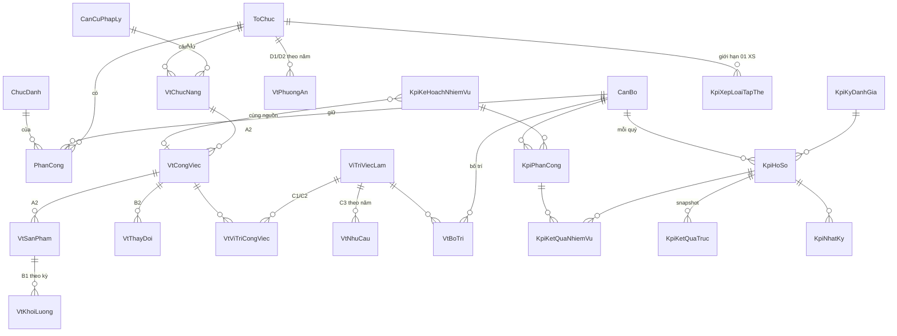

# Thiết kế CSDL liên kết: Vị trí việc làm (VTVL) – Nhiệm vụ – Người – KPI – Phòng – Lãnh đạo

> Lập 26/10/2026. **Chỉ thiết kế, chưa sửa `schema.prisma`, chưa tạo migration, chưa nhập dữ liệu thật.**
> Căn cứ: Kết luận 107-KL/TW (17/10/2026), Kế hoạch 109-KH/TU (25/10/2026), Phụ lục KPI Kế hoạch 2026, CV 9409/SXD-VP và CSDL hiện có (`CanBo`, `ToChuc`, `ChucDanh`, `PhanCong`).

> **Cập nhật 28/10/2026:** đã có Quyết định phê duyệt VTVL (QĐ 1239/QĐ-SXD) và 94 bản mô tả công việc. Bảng `vi_tri_viec_lam` (§4.1) nay là **danh mục chính thức 65 mã** nạp từ QĐ, và có thêm nhóm bảng bản mô tả, hồ sơ xếp ngạch. Xem `03-vtvl-chinh-thuc-cap-nhat.md`; chỗ nào hai bản khác nhau thì theo bản 03.

## 0. Điều cần nói trước

1. **Chưa có Hướng dẫn 07-HD/BTCTW và 09 biểu nghiệp vụ.** Hai văn bản được dán chỉ nêu tên 08 bước và các biểu A1, A2, B1, B2, C1, C2, C3, D1, D2 (không có cột, công thức, mã định danh). Thiết kế dưới đây bám **ý nghĩa từng bước**, nên tên cột và công thức quỹ giờ **phải đối chiếu lại khi có bộ biểu Excel của Trung ương**. Kế hoạch 109 cấm "tự đặt định mức hoặc hệ số quy đổi" và "sửa ô công thức đã khóa": hệ thống chỉ lưu và kiểm tra, **không tự đặt định mức**.
2. **Mốc gần nhất rất sát:** A1, A2 trước **28/10**; B1, B2 **30/10**; C1–C3 **02/11**; D1, D2 và xác nhận **04/11**; báo cáo bộ dữ liệu **08/11**; phương án biên chế **13/11 (đơn vị) → 18/11 (gửi Trung ương)**. Cùng lúc hồ sơ KPI quý III nộp **29/10**. Việc kê khai chính thức nên làm **trên bộ biểu Excel của Trung ương**; CSDL này là nơi **chuẩn bị, đối chiếu, kiểm tra trùng/sót** và cấp dữ liệu, không thay thế bộ biểu chính thức.
3. Kết luận 107 đặt nguyên tắc: **không đồng nhất một VTVL với một cá nhân hay một chỉ tiêu biên chế**; quản lý theo nhiệm vụ – sản phẩm – kết quả. Thiết kế vì vậy tách rõ **VTVL (vị trí)** khỏi **người** và khỏi **biên chế**.

## 1. Văn bản hướng dẫn nói gì (rút ra yêu cầu dữ liệu)

| Yêu cầu trong văn bản | Hệ quả thiết kế |
|---|---|
| Chuỗi 08 bước A1→A2→B1→B2→C1/C2→C3→D1/D2→kiểm tra | Mô hình dữ liệu **một chuỗi khoá ngoại**: chức năng → công việc → sản phẩm → khối lượng → VTVL → nhu cầu → phương án |
| Kỳ thống kê sản phẩm 01/10/2025–30/9/2026; nhân lực tại 30/9/2026 | Mọi số liệu gắn **kỳ** và **ngày chốt**; nhân sự dùng lịch sử có hiệu lực theo ngày (đã có `PhanCong.tuNgay/denNgay`) |
| Không tự điền số 0 khi thiếu; tách "đủ căn cứ / cần kiểm chứng / chưa xác định" | Cột số liệu **cho phép NULL**; cột `trang_thai_kiem_chung` bắt buộc; thống kê tách theo trạng thái |
| Kế thừa dữ liệu đã xác nhận, không kê khai lại | Có `phien_ban` + `thay_the_phien_ban_id`; mỗi kỳ chỉ lấy phiên bản xác nhận mới nhất |
| Không tính trùng nhiệm vụ, sản phẩm, thời gian lao động, nhân lực kiêm nhiệm | Ràng buộc: tổng tỷ lệ thời gian của một người tại một thời điểm ≤ 100%; một sản phẩm có đúng một đơn vị chủ trì tính khối lượng |
| Nhu cầu lao động quy đổi ≠ số người cần bố trí ≠ số có thể bố trí ≠ biên chế được giao | Bảng phương án có **bốn cột riêng**; không có cột "tự tăng biên chế" |
| D2 chính thức chỉ khi C3 đã kiểm chứng | Ràng buộc trạng thái: không chuyển D2 sang `CHINH_THUC` nếu còn dòng C3 chưa `DA_KIEM_CHUNG` |
| Người đứng đầu chịu trách nhiệm xác nhận; lưu phiên bản, nhật ký | Bảng xác nhận + nhật ký (đã có `AuditLog` để dùng lại) |
| Bảo vệ bí mật nhà nước, thông tin cá nhân | Bảng mới thuộc nhóm **nhạy cảm**: mặc định chặn với chatbot, bị xoá khi tạo dữ liệu staging (xem §7) |

## 2. Ý tưởng cốt lõi: "xương sống" và hai nhánh dùng chung dữ liệu

```
                  ┌────────────── XƯƠNG SỐNG NHÂN SỰ (đã có) ──────────────┐
                  │  ToChuc (Sở > Phòng) ◄── PhanCong ──► CanBo ──► ChucDanh │
                  └──────────────┬───────────────────────────┬──────────────┘
                                 │                           │
        NHÁNH VỊ TRÍ VIỆC LÀM (đề án 2027–2031)     NHÁNH KPI QUÝ (hồ sơ xếp loại)
        chức năng → công việc → sản phẩm            nhiệm vụ kế hoạch năm (Phụ lục KPI)
        → khối lượng → VTVL → nhu cầu → biên chế    → phân công người → kết quả quý → xếp loại
                                 └──── dùng CHUNG: công việc / sản phẩm / người ────┘
```

- **Một lần nhập, hai mục đích.** Dòng "Mục tiêu, nhiệm vụ – Sản phẩm – Người thực hiện" của Phụ lục KPI chính là nội dung công việc/sản phẩm của biểu A1/A2. Nếu nhập hai nơi riêng sẽ lệch nhau; thiết kế cho phép **một nhiệm vụ kế hoạch gắn vào một công việc VTVL** để cùng nguồn.
- **Người ở giữa.** Từ một `CanBo`: lịch sử `PhanCong` (phòng, chức danh, lãnh đạo?) → `vt_bo_tri` (VTVL, tỷ lệ thời gian) → `kpi_phan_cong_nhiem_vu` (nhiệm vụ, vai trò) → `kpi_ho_so_ca_nhan` (kết quả từng quý). Đi **lên** thì gom được theo phòng, theo lãnh đạo phụ trách, toàn Sở; đi **xuống** thì ra từng nhiệm vụ.

## 3. Sơ đồ quan hệ (rút gọn)



## 4. Bảng đề xuất (nháp, chưa áp dụng)

Quy ước: tiền tố `vt_` (vị trí việc làm), `kpi_` (đánh giá). Mọi bảng có `id cuid`, `created_at`, `updated_at`; bảng số liệu có `ky`, `phien_ban`, `trang_thai_kiem_chung`, `nguon`.

### 4.1 Nhánh vị trí việc làm

| Bảng | Biểu | Nội dung chính | Khoá/ràng buộc |
|---|---|---|---|
| `can_cu_phap_ly` | A1 | loại, số hiệu, ngày, cơ quan ban hành, hiệu lực, tệp | unique(số hiệu, ngày); dùng lại cho mọi bảng |
| `vt_chuc_nang` | A1 | toChucId, mã, tên, tình trạng sau sắp xếp (`TIEP_TUC/TIEP_NHAN/CHUYEN_GIAO/CHAM_DUT`), cơ quan chủ trì/phối hợp | FK ToChuc; N-N `can_cu_phap_ly` |
| `vt_cong_viec` | A2 | chucNangId, mã, tên, công đoạn (bảng con `vt_cong_doan`) | FK chức năng |
| `vt_san_pham` | A2 | congViecId, tên, đơn vị tính, loại (văn bản, hồ sơ giải quyết, báo cáo…) | FK công việc |
| `vt_khoi_luong` | B1 | sanPhamId, **ky**, soLuong (NULL được), gioMoiSanPham (NULL được), nguồn minh chứng, trạng thái kiểm chứng | unique(sản phẩm, kỳ, phiên bản) |
| `vt_thay_doi` | B2 | congViecId, lý do (`CHUYEN_DOI_SO/TU_CHU/THUE_DICH_VU/XA_HOI_HOA`), mô tả, tỷ lệ tác động (NULL được) | |
| `vi_tri_viec_lam` | C1 | toChucId, mã, tên, nhóm (lãnh đạo/chuyên môn/phục vụ), ngạch/chức danh nghề nghiệp, hiệu lực | **không** có cột "số biên chế" (đúng tinh thần 107) |
| `vt_vi_tri_cong_viec` | C1/C2 | viTriId, congViecId, tỷ trọng, ghi chú bản mô tả | cầu nối N-N |
| `vt_khung_nang_luc` | C2 | viTriId, năng lực, mức yêu cầu | |
| `vt_nhu_cau` | C3 | viTriId, nam (2027–2031), lao động quy đổi (**kết quả tính từ B1 + quỹ giờ**, lưu cùng `cong_thuc_phien_ban`), số người cần bố trí | không nhập tay nếu ô công thức khoá |
| `vt_phuong_an` | D1/D2 | toChucId, nam, `bienCheDuocGiao`, `hienCoTai30_9_2026`, `canBoTri`, `coTheBoTri`, `deNghiDieuChinh`, trạng thái (`NHAP/TINH_THU/CHINH_THUC`) | `CHINH_THUC` chỉ khi mọi C3 liên quan `DA_KIEM_CHUNG` |
| `vt_bo_tri` | D1 | **canBoId**, viTriId, tyLeThoiGian (0–100), loại (`CHINH/KIEM_NHIEM`), tuNgay, denNgay, quyết định | trigger: Σ tyLe của một người tại một ngày ≤ 100 |
| `vt_xac_nhan` | Bước 8 | phạm vi, kỳ, phiên bản, người xác nhận, nội dung chưa đủ căn cứ | |

### 4.2 Nhánh KPI quý

| Bảng | Nội dung chính | Ghi chú |
|---|---|---|
| `kpi_ke_hoach_nhiem_vu` | nam, phan A/B, toChucId, nhóm, stt, tên, sản phẩm, thời hạn gốc, **quý bắt đầu/kết thúc/liên tục** (từ `thoi-han.ts`), trục xác nhận / trục gợi ý, hệ số, căn cứ, `vt_cong_viec_id` (tuỳ chọn) | nạp từ `ke-hoach-2026.json` (350 dòng); nhận được cả Kế hoạch 2027 |
| `kpi_phan_cong` | nhiemVuId, canBoId, vaiTro (`CHU_TRI/PHOI_HOP/THUC_HIEN`), quyTu, quyDen, ghiChu phía Bắc/Nam | thay chuỗi tên người của PDF; unique(nhiệm vụ, người, vai trò) |
| `kpi_lanh_dao_phu_trach` | nhiemVuId, lãnh đạo (`canBoId`), vai trò | thay cột "Lãnh đạo phụ trách" |
| `kpi_ky_danh_gia` | nam, quy, hạn nộp, văn bản căn cứ (CV 9409…), trạng thái `MO/DONG`, bộ tham số (ngưỡng 90/70/50, điểm trục 35/10/7/8/5/5) | **tham số đưa vào bảng** để quý sau/văn bản mới không phải sửa code |
| `kpi_ho_so` | kyId, canBoId, **chụp lại** (toChucId, chức danh, `la_lanh_dao`, vtvlId tại thời điểm), diemChung, chiSoD, trạng thái quy trình, tổng điểm, mức theo điểm, mức đề xuất, mức chính thức, phiên bản | unique(kỳ, người); quy trình `NHAP → CA_NHAN_NOP → TRUONG_PHONG_XEM_XET → SO_DUYET → KHOA` |
| `kpi_ket_qua_nhiem_vu` | hoSoId, phanCongId, chon, truc, heSo, hoanThanh, dungHan, chatLuongDat, vuotMuc (đều NULL = chưa nhập), minh chứng (tệp), nhận xét | tương đương Phụ lục 1 + dữ liệu cho Phụ lục 2 |
| `kpi_ket_qua_truc` | hoSoId, trục, A, B, C, D, KPI, điểm tối đa sau chuyển, điểm | **chụp kết quả tại thời điểm khoá** để số cũ không đổi khi sửa tham số |
| `kpi_xep_loai_tap_the` | toChucId, kyId, người được chọn xuất sắc, giải trình, người quyết | thể hiện giới hạn 01 người/tập thể |
| `kpi_nhat_ky` | hoSoId, ai, khi nào, từ→đến, ghi chú | hoặc dùng chung `AuditLog` |

Vì sao **chụp lại (snapshot)** ở `kpi_ho_so` và `kpi_ket_qua_truc`: một người đổi phòng hoặc chức danh sau quý III không được làm thay đổi hồ sơ quý III đã khoá.

## 5. Phần "thông minh": liên kết, tính toán, kiểm tra

**Tính tự động (đã có mã):** `lib/kpi/tinh-kpi.ts` đọc `kpi_ket_qua_nhiem_vu` + tham số kỳ → ghi `kpi_ket_qua_truc` và các cột tổng điểm; `lib/kpi/thoi-han.ts` quy thời hạn về quý; `lib/kpi/phan-truc.ts` gợi ý trục.

**Điền sẵn từ xương sống (bỏ khai tay):**
- `la_lanh_dao`, phòng, chức danh lấy từ `PhanCong` đang hiệu lực + `ChucDanh.isLanhDao` — thay cho việc cán bộ tự chọn "Có/Không" như bảng Excel hiện nay.
- Danh mục nhiệm vụ quý của từng người sinh từ `kpi_phan_cong` + `kpi_ke_hoach_nhiem_vu` + quý.

**Kiểm tra chéo (trang cảnh báo, chạy bằng view):**

| Kiểm tra | Ý nghĩa |
|---|---|
| Người có nhiệm vụ KPI nhưng **không có `vt_bo_tri`** | thiếu VTVL |
| VTVL có công việc nhưng **không có người** / người nhưng không có công việc | nơi thừa, nơi thiếu |
| Σ tỷ lệ thời gian của một người ≠ ~100% | tính trùng / bỏ sót nhân lực kiêm nhiệm |
| Nhiệm vụ KPI không gắn `vt_cong_viec` | kế hoạch năm lệch chức năng đã kê khai |
| Sản phẩm có khối lượng nhưng thiếu `gioMoiSanPham`, hoặc số liệu `CHUA_KIEM_CHUNG` | không được vào D2 chính thức |
| Tập thể có >1 người đề xuất xuất sắc | vượt giới hạn CV 9409 |
| So sánh `lao động quy đổi` (C3) với số người bố trí thực tế (D1) | chỉ để xem xét; **không tự suy ra tăng biên chế** |

**Thống kê chính xác từng người → phòng → lãnh đạo → Sở (view, không lưu trùng):**
- `v_kpi_nguoi_quy`: người × quý → điểm, xếp loại, số nhiệm vụ, tỷ lệ đúng hạn; có xu hướng nhiều quý.
- `v_kpi_phong_quy`: phòng × quý → phân bố xếp loại, điểm trung bình, nhiệm vụ trễ, người vượt giới hạn.
- `v_kpi_lanh_dao`: lãnh đạo phụ trách → các phòng/nhiệm vụ → kết quả (qua `kpi_lanh_dao_phu_trach` và `PhanCongLinhVuc` đã có).
- `v_vtvl_nguoi_phong`: VTVL × người × phòng × tỷ lệ; thừa/thiếu theo ngày chốt 30/9/2026.
- `v_nhiem_vu_chua_giao` / `v_nguoi_khong_nhiem_vu`: kiểm soát độ phủ kế hoạch.

**Gợi ý bằng AI (chỉ là đề xuất, người xác nhận):** gán trục 1–6, gắn nhiệm vụ KPI với công việc VTVL, phát hiện nhiệm vụ trùng giữa các phòng. Luôn lưu `nguon_gan = 'GOI_Y_MAY' | 'NGUOI_XAC_NHAN'`. Không để AI tự ghi trạng thái kiểm chứng hay tự đặt định mức.

## 6. Ràng buộc toàn vẹn nên đặt ở mức CSDL

- `CHECK` miền giá trị: tyLeThoiGian 0–100; điểm chung 0–30; chỉ số 0–1; quý 1–4.
- `UNIQUE`: (kỳ, người) trên hồ sơ; (nhiệm vụ, người, vai trò) trên phân công; (sản phẩm, kỳ, phiên bản) trên khối lượng.
- Trigger: Σ tỷ lệ thời gian ≤ 100% theo ngày; chặn sửa hồ sơ khi `trang_thai = KHOA` (chỉ mở lại có lý do + nhật ký); chặn `vt_phuong_an` → `CHINH_THUC` khi C3 chưa kiểm chứng.
- Khoá ngoại **không** `ON DELETE CASCADE` với số liệu đã xác nhận (dùng huỷ mềm `hieu_luc_den`).
- Phiên bản: dòng cũ giữ nguyên, dòng mới trỏ `thay_the_phien_ban_id`.

## 7. Bảo mật và quản trị dữ liệu

- KPI cá nhân và biên chế là **dữ liệu nhân sự nhạy cảm**. Nhất quán với quyết định B0 (Q3): chatbot **chặn** các bảng `kpi_*` và `vt_bo_tri` ở mức tool; công cụ ẩn danh hoá đã theo nguyên tắc "bảng mới mặc định bị xoá" nên staging không chứa dữ liệu này.
- Phân quyền theo vai trò: cán bộ xem/sửa **hồ sơ của mình** khi kỳ còn mở; Trưởng phòng xem **phòng mình**; Văn phòng Sở và lãnh đạo Sở xem toàn Sở; mọi lần xem/sửa ghi `AuditLog`.
- Sao lưu và khôi phục theo B0; không đưa dữ liệu thật lên VPS staging.
- Kết luận 107 và Kế hoạch 109 yêu cầu bảo vệ bí mật nhà nước và thông tin cá nhân: cần xin ý kiến lãnh đạo Sở về nơi đặt máy chủ và phạm vi người dùng trước khi triển khai thật.

## 8. Lộ trình đề xuất (mỗi bước cần duyệt riêng)

| Pha | Việc | Điều kiện |
|---|---|---|
| P0 (ngay, 26–29/10) | Tiếp tục dùng **Excel** cho hồ sơ KPI quý III (đã có) và bộ biểu Excel Trung ương cho A1–D2; **không** chờ CSDL | — |
| P1 | Nạp nhóm KPI: `kpi_ke_hoach_nhiem_vu`, `kpi_phan_cong`, `kpi_ky_danh_gia`, `kpi_ho_so`… + giao diện cán bộ nhập, trưởng phòng duyệt, xuất Phụ lục | Duyệt migration; đối chiếu tên với `CanBo`; có mẫu Phụ lục 1/2/3a/3b chính thức |
| P2 | Nạp kết quả bộ biểu A1–D2 đã hoàn thành từ Excel vào nhóm `vt_*`; bật các kiểm tra chéo | Có Hướng dẫn 07 + bộ biểu; khớp tên cột |
| P3 | View thống kê người → phòng → lãnh đạo → Sở; cảnh báo; tích hợp trang lãnh đạo | P1, P2 |
| P4 | Gợi ý bằng AI có người xác nhận | Sau khi dữ liệu sạch |

Quy ước làm migration: SQL thủ công trong `prisma/migrations_manual/` (số tiếp theo **050**) kèm rollback, chạy thử trên máy staging nội bộ trước.

## 9. Câu hỏi cần chủ hệ thống/Văn phòng Sở trả lời

1. Bạn có Hướng dẫn 07-HD/BTCTW và bộ 09 biểu Excel không? Cho tôi tệp để đối chiếu cột và công thức trước khi chốt `vt_*`.
2. Bảng `CanBo` hiện đã có đủ 83 người của Phụ lục KPI chưa, và `PhanCong` đã phản ánh đúng chức danh lãnh đạo từng phòng chưa? (Quyết định nguồn sự thật cho "là lãnh đạo".)
3. Văn phòng Sở có mẫu/hệ số quy đổi (HD 05/HD-BTCTU) và Phụ lục 1, 2, 3a, 3b không?
4. Hồ sơ KPI có cần lưu **minh chứng** (tệp) từng nhiệm vụ không? Nếu có, nơi lưu và dung lượng.
5. Ai được xem điểm KPI của người khác ngoài trưởng phòng và lãnh đạo Sở?
6. Chọn **P0 trước**: tôi có nên chuẩn bị nhóm bảng `kpi_*` (P1) thành bản nháp migration `050` để duyệt, hay chờ có bộ biểu Trung ương rồi làm cả hai nhóm cùng lúc?
